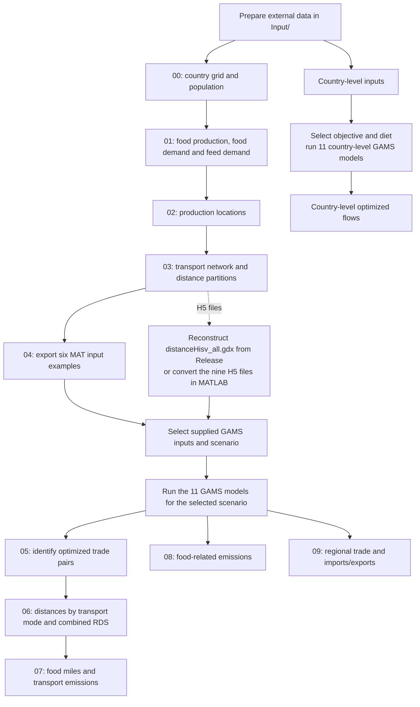
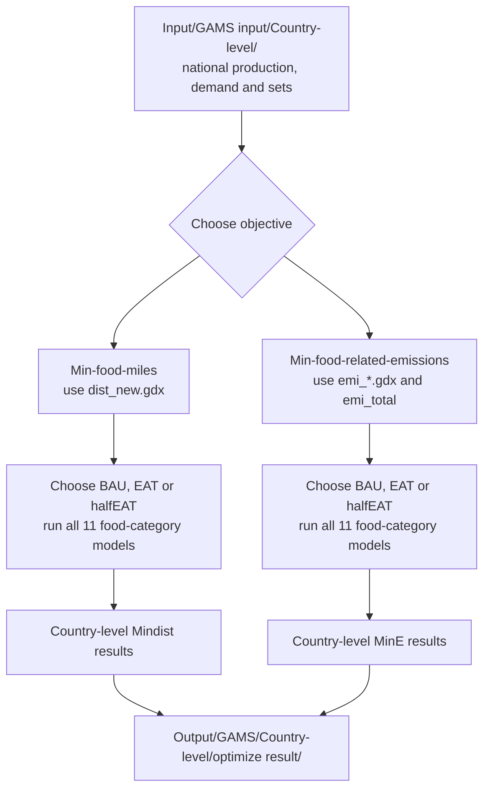

# *Lower global food system emissions via integrating dietary transition and localized food supply*

## Contents

- [1. Overview](#1-overview)
- [2. Data preparation](#2-data-preparation)
  - [2.1. Livestock Production Systems data](#21-livestock-production-systems-data)
    - [2.1.1. Livestock production data](#211-livestock-production-data)
    - [2.1.2. Grain-based feed consumption data](#212-grain-based-feed-consumption-data)
    - [2.1.3. Data preparation instructions](#213-data-preparation-instructions)
  - [2.2. SPAM crop production data](#22-spam-crop-production-data)
    - [2.2.1. Data used in this study](#221-data-used-in-this-study)
    - [2.2.2. Data preparation instructions](#222-data-preparation-instructions)
    - [2.2.3. Version and reproducibility](#223-version-and-reproducibility)
  - [2.3. Gridded Population of the World (GPWv4) population data](#23-gridded-population-of-the-world-gpwv4-population-data)
    - [2.3.1. Data used in this study](#231-data-used-in-this-study)
    - [2.3.2. Data preparation instructions](#232-data-preparation-instructions)
    - [2.3.3. Version and reproducibility](#233-version-and-reproducibility)
  - [2.4. Transportation networks](#24-transportation-networks)
    - [2.4.1. GRIP4 road density data](#241-grip4-road-density-data)
      - [2.4.1.1. Dataset information](#2411-dataset-information)
      - [2.4.1.2. Data used in this study](#2412-data-used-in-this-study)
      - [2.4.1.3. Expected files](#2413-expected-files)
      - [2.4.1.4. Data preparation instructions](#2414-data-preparation-instructions)
      - [2.4.1.5. Reference](#2415-reference)
    - [2.4.2. Global Shipping Lanes data](#242-global-shipping-lanes-data)
      - [2.4.2.1. Dataset information](#2421-dataset-information)
      - [2.4.2.2. Data used in this study](#2422-data-used-in-this-study)
      - [2.4.2.3. Data preparation instructions](#2423-data-preparation-instructions)
      - [2.4.2.4. Processing in the transportation network](#2424-processing-in-the-transportation-network)
      - [2.4.2.5. Reference](#2425-reference)
  - [2.5. GADM administrative boundary data](#25-gadm-administrative-boundary-data)
    - [2.5.1. Data used in this study](#251-data-used-in-this-study)
    - [2.5.2. Data preparation instructions](#252-data-preparation-instructions)
    - [2.5.3. Download using GitHub CLI](#253-download-using-github-cli)
    - [2.5.4. Data organization](#254-data-organization)
- [3. Code and reproducibility](#3-code-and-reproducibility)
  - [3.1. Original code archive for verification](#31-original-code-archive-for-verification)
- [4. Software requirements](#4-software-requirements)
- [5. Data availability](#5-data-availability)
  - [5.1. Large GAMS input dataset](#51-large-gams-input-dataset)
  - [5.2. Step 1. Download the GDX dataset](#52-step-1-download-the-gdx-dataset)
    - [5.2.1. Option A. Manual download (Windows, macOS, and Linux)](#521-option-a-manual-download-windows-macos-and-linux)
    - [5.2.2. Option B. Download using GitHub CLI (Windows, macOS, and Linux)](#522-option-b-download-using-github-cli-windows-macos-and-linux)
  - [5.3. Step 2. Reconstruct the original GDX file](#53-step-2-reconstruct-the-original-gdx-file)
    - [5.3.1. Option A. macOS and Linux](#531-option-a-macos-and-linux)
    - [5.3.2. Option B. Windows (PowerShell)](#532-option-b-windows-powershell)
  - [5.4. Step 3. Verify data integrity](#54-step-3-verify-data-integrity)
    - [5.4.1. Option A. macOS](#541-option-a-macos)
    - [5.4.2. Option B. Linux](#542-option-b-linux)
    - [5.4.3. Option C. Windows (PowerShell)](#543-option-c-windows-powershell)
  - [5.5. Step 4. Use the reconstructed dataset in GAMS](#55-step-4-use-the-reconstructed-dataset-in-gams)
  - [5.6. Additional data and reproducibility information](#56-additional-data-and-reproducibility-information)
- [6. How to run the code](#6-how-to-run-the-code)
  - [6.1. Workflow](#61-workflow)
  - [6.2. Prepare the working directory and software](#62-prepare-the-working-directory-and-software)
  - [6.3. Run preprocessing](#63-run-preprocessing)
  - [6.4. Prepare GAMS inputs and run optimization](#64-prepare-gams-inputs-and-run-optimization)
  - [6.5. Run LFS-Base post-processing](#65-run-lfs-base-post-processing)
  - [6.6. Run country-level sensitivity analyses](#66-run-country-level-sensitivity-analyses)
- [7. Citation](#7-citation)
- [8. License](#8-license)

## 1. Overview

This repository provides the code and supporting materials for reproducing the analyses presented in the manuscript *Lower global food system emissions via integrating dietary transition and localized food supply*.

The study investigates the potential of integrating localized food supply (LFS) and dietary transition strategies to reduce global food-system greenhouse gas (GHG) emissions. By combining spatial optimization, transportation network analysis, and GHG emission accounting, we evaluate the impacts of alternative food supply and dietary scenarios on food miles, food-related emissions, and transportation emissions.

The analysis considers spatially explicit food production and consumption, transportation infrastructure, regional production capacities, and alternative dietary demands.

## 2. Data preparation

### 2.1. Livestock Production Systems data

The spatially explicit livestock production and grain-based feed consumption data were obtained from the **Livestock Production Systems** dataset available through the CSIRO Data Access Portal.

**Data source:**

[Livestock Production Systems — CSIRO Data Access Portal](https://data.csiro.au/collection/csiro:29893)

To reproduce the analysis, download the following 14 ZIP archives, comprising seven livestock production datasets and seven grain-based feed consumption datasets.

#### 2.1.1. Livestock production data

Download the following seven files:

1.  `bvmeat_kg.zip`
2.  `bvmilk_kg.zip`
3.  `pimeat_kg.zip`
4.  `poeggs_kg.zip`
5.  `pomeat_kg.zip`
6.  `sgmeat_kg.zip`
7.  `sgmilk_kg.zip`

These datasets provide spatially explicit livestock production information for the corresponding livestock product categories.

#### 2.1.2. Grain-based feed consumption data

Download the following seven files:

1.  `bvmeat_grai.zip`
2.  `bvmilk_grai.zip`
3.  `ls_grai.zip`
4.  `pimeat_grai.zip`
5.  `po_grai.zip`
6.  `sgmeat_grai.zip`
7.  `sgmilk_grai.zip`

These datasets provide spatially explicit estimates of grain biomass consumption associated with livestock production, expressed in kg/km²/year.

#### 2.1.3. Data preparation instructions

1.  Open the [CSIRO dataset page](https://data.csiro.au/collection/csiro:29893).
2.  Download all 14 ZIP archives listed above.
3.  Extract the downloaded archives.
4.  Place the extracted files in the following directory within this repository:

`Input/Livestock Production Systems data/`

Preserve the original filenames and any required directory structure to ensure compatibility with the subsequent data-processing scripts.

### 2.2. SPAM crop production data

The spatially disaggregated crop production data were obtained from the International Food Policy Research Institute (IFPRI)'s Spatial Production Allocation Model (SPAM).

**Data source:**

[Global Spatially-Disaggregated Crop Production Statistics Data for 2020, Version 1.0 — Historical dataset record](https://cgspace.cgiar.org/items/e3cb3635-4bb7-4b88-b90d-3d1c76364f82)

**Dataset information:**

- **Dataset:** Global Spatially-Disaggregated Crop Production Statistics Data for 2020
- **Model:** Spatial Production Allocation Model (SPAM)
- **Version used in this study:** 2020 Version 1.0
- **Download year:** 2024
- **Reference year:** 2020
- **Spatial resolution:** 5 arc-minutes
- **Data provider:** International Food Policy Research Institute (IFPRI)
- **Persistent identifier:** <https://doi.org/10.7910/DVN/SWPENT>

#### 2.2.1. Data used in this study

This study uses the **crop production layers** from SPAM 2020 Version 1.0 to represent the spatial distribution of crop production.

The required inputs are the production data for the crops included in the analysis, rather than the corresponding harvested area, physical area, or yield layers.

#### 2.2.2. Data preparation instructions

1.  Open the [SPAM 2020 Version 1.0 historical dataset record](https://cgspace.cgiar.org/items/e3cb3635-4bb7-4b88-b90d-3d1c76364f82).
2.  Download the crop production data files for the crops included in this study.
3.  Extract the downloaded archives, where applicable.
4.  Place the extracted files in the following directory within this repository:

`Input/SPAM data/`

Preserve the original filenames and directory structure required by the data-processing scripts.

#### 2.2.3. Version and reproducibility

The analysis uses **SPAM 2020 Version 1.0**, downloaded in 2024. This is the version used to prepare the original analysis inputs.

The current SPAM dataset page lists Version 2.0, Release 2:

[SPAM 2020 Version 2.0, Release 2 — Current dataset record](https://doi.org/10.7910/DVN/SWPENT)

Version 2.0 should not be substituted for Version 1.0 when reproducing the original analysis, because revisions to the underlying spatial production estimates may affect the results. Users should obtain Version 1.0 from the historical dataset record linked above.

### 2.3. Gridded Population of the World (GPWv4) population data

Gridded population data were obtained from the **Gridded Population of the World, Version 4 (GPWv4)** dataset developed by the NASA Socioeconomic Data and Applications Center (SEDAC).

**Data source:**

[GPWv4 — Socioeconomic Data and Applications Center (SEDAC)](https://sedac.ciesin.columbia.edu/data/collection/gpw-v4)

#### 2.3.1. Data used in this study

This study uses gridded population data to represent the spatial distribution of population.

The archived GPWv4 Beta release provides the following population-related datasets:

- **Population Count:** <https://doi.org/10.7927/H4BG2KXS>
- **UN-Adjusted Population Count:** <https://doi.org/10.7927/H4PR7SX1>
- **Population Density:** <https://doi.org/10.7927/H46T0JKB>
- **UN-Adjusted Population Density:** <https://doi.org/10.7927/H4TH8JNR>

For population-count grids, use the **Population Count** dataset corresponding to the original input data. Do not substitute population density or UN-adjusted population count unless that is the variable used by the original analysis.

The GPWv4 Beta release is archived separately from the subsequent Version 4.0 release. The two releases differ in certain datasets and country-level population estimates.

#### 2.3.2. Data preparation instructions

1.  Open the [archived GPWv4 Beta Population Count dataset](https://doi.org/10.7927/H4BG2KXS).
2.  Download the gridded population-count data required by the analysis.
3.  Extract the downloaded archive, where applicable.
4.  Place the extracted raster files in the following directory within this repository:

`Input/Other data/population/`

Preserve the original filenames and spatial reference information required by the data-processing scripts.

#### 2.3.3. Version and reproducibility

The GPWv4 Beta release was made available before the subsequent Version 4.0 release. According to the June 2016 Version 4.0 release notes, changes included revisions to Egypt's administrative boundaries and population estimates, corrections to data integration for Panama and Poland, and the addition of new datasets.

The Beta population-count data are available through the archived DOI listed above. Users reproducing the original analysis should use the same GPWv4 release and population variable as the original input data rather than automatically substituting the later Version 4.0 release.

The release notes and information on the Beta archive are available through the [GPWv4 data documentation](https://sedac.ciesin.columbia.edu/data/collection/gpw-v4).

### 2.4. Transportation networks

Transportation network data were obtained from global road density rasters and global shipping route datasets. These data provide the spatial infrastructure information used to construct the transportation network and associated friction surfaces.

#### 2.4.1. GRIP4 road density data

The road density data were obtained from the **Global Roads Inventory Project, Version 4 (GRIP4)**.

**Data sources:**

- [GRIP global roads database — Official GLOBIO download page](https://www.globio.info/download-grip-dataset)
- [GRIP4 — PBL Data Portal](https://dataportaal.pbl.nl/GRIP4)
- [GRIP4 supplementary spatial data — Zenodo](https://doi.org/10.5281/zenodo.6420961)

##### 2.4.1.1. Dataset information

- **Dataset:** Global Roads Inventory Project, Version 4
- **Data type:** Global road density raster data
- **Spatial resolution:** 5 arc-minutes (approximately 0.083333333 degrees)
- **Spatial reference:** WGS84 geographic coordinates (latitude and longitude)
- **Unit:** Meters of road per square kilometer per grid cell
- **Road categories:** Total road network and five road types
- **Reference:** Meijer et al. (2018)

GRIP4 provides global road density rasters representing the spatial distribution of road infrastructure. The dataset includes the total road network and five road categories: highways, primary roads, secondary roads, tertiary roads, and local roads.

##### 2.4.1.2. Data used in this study

Download the six global road density raster archives from the official GRIP4 download page.

| Dataset                   | Description                                 |
|---------------------------|---------------------------------------------|
| `GRIP4_density_total.zip` | Total road density, all road types combined |
| `GRIP4_density_tp1.zip`   | Type 1: Highways                            |
| `GRIP4_density_tp2.zip`   | Type 2: Primary roads                       |
| `GRIP4_density_tp3.zip`   | Type 3: Secondary roads                     |
| `GRIP4_density_tp4.zip`   | Type 4: Tertiary roads                      |
| `GRIP4_density_tp5.zip`   | Type 5: Local roads                         |

All six datasets can be downloaded from the [official GRIP4 download page](https://www.globio.info/download-grip-dataset). Alternatively, consult the [PBL Data Portal](https://dataportaal.pbl.nl/GRIP4).

##### 2.4.1.3. Expected files

After extracting the downloaded archives, retain the following files where supplied by the dataset:

| File | Description |
|----|----|
| `GRIP4_TOTAL_DENS_m_km2.asc` | Density of all road types combined |
| `GRIP4_TP1_DENS_m_km2.asc` | Density of highways |
| `GRIP4_TP2_DENS_m_km2.asc` | Density of primary roads |
| `GRIP4_TP3_DENS_m_km2.asc` | Density of secondary roads |
| `GRIP4_TP4_DENS_m_km2.asc` | Density of tertiary roads |
| `GRIP4_TP5_DENS_m_km2.asc` | Density of local roads |
| `GRIP4_area_land_km2.asc` | Land area per 5-arcminute grid cell, in km² |
| `GRIP4_density_m_km2.lyr` | Example ArcGIS layer for road density classification |

The `.asc` files are ASCII grid rasters. The `.lyr` file is an example ArcGIS layer for visualization and is not required for numerical raster analysis.

##### 2.4.1.4. Data preparation instructions

1.  Open the [official GRIP4 download page](https://www.globio.info/download-grip-dataset).
2.  Download the six global road density raster ZIP archives listed above.
3.  Extract the downloaded archives.
4.  Place the extracted files in the following directory within this repository:

`Input/Other data/transport/`

Preserve the original filenames and raster header information. Ensure that the rasters retain their original spatial resolution and WGS84 coordinate reference.

##### 2.4.1.5. Reference

Meijer, J. R., Huijbregts, M. A. J., Schotten, C. G. J., & Schipper, A. M. (2018). Global patterns of current and future road infrastructure. *Environmental Research Letters*, 13, 064006.

<https://doi.org/10.1088/1748-9326/aabd42>

#### 2.4.2. Global Shipping Lanes data

The global shipping route data were obtained from the **Global Shipping Lanes** dataset published by Benden (2022).

**Data sources:**

- [Global Shipping Lanes — Zenodo dataset](https://doi.org/10.5281/zenodo.6361763)
- [Global Shipping Lanes — GitHub repository](https://github.com/newzealandpaul/Shipping-Lanes)

##### 2.4.2.1. Dataset information

- **Dataset:** Global Shipping Lanes
- **Author:** Benden, P.
- **Publication year:** 2022
- **Data type:** Global shipping route vector data
- **Available formats:** GeoJSON and ESRI Shapefile
- **Route categories:** Major, Middle, and Minor
- **Persistent identifier:** <https://doi.org/10.5281/zenodo.6361763>

The dataset represents global shipping lanes derived from the *Map of The World's Oceans* published by the Central Intelligence Agency (CIA) in October 2012, with subsequent corrections to the original map.

The route data contain three categories:

- **Major:** Major shipping lanes.
- **Middle:** Intermediate shipping lanes.
- **Minor:** Minor shipping lanes.

##### 2.4.2.2. Data used in this study

This study uses the vector shipping route network to represent maritime transportation corridors.

The original shipping route data are provided in vector format. For integration with the other transportation networks, the routes are converted into a standardized 5-arcminute raster network during data processing.

##### 2.4.2.3. Data preparation instructions

1.  Open the [Global Shipping Lanes dataset on Zenodo](https://doi.org/10.5281/zenodo.6361763) or the [GitHub repository](https://github.com/newzealandpaul/Shipping-Lanes).
2.  Download the shipping route dataset.
3.  Extract the downloaded archive, where applicable.
4.  Retain the original vector data, including the GeoJSON or Shapefile and its associated files.
5.  Place the extracted files in the following directory within this repository:

`Input/Other data/transport/`

Preserve the original filenames and route-type attributes, particularly the `Major`, `Middle`, and `Minor` classifications.

##### 2.4.2.4. Processing in the transportation network

The shipping route data are converted from vector features into a 5-arcminute raster network to match the spatial resolution used for the transportation analysis.

In the original transportation network construction:

- Major shipping routes are assigned a travel speed of 19 km/h.
- Middle and minor shipping routes are assigned a travel speed of 10 km/h.
- Oceanic cells outside the designated shipping routes are assigned a higher relative transport cost to discourage unrealistic off-route transport.

The rasterized shipping network is integrated with road and rail networks to construct the transportation friction surface.

##### 2.4.2.5. Reference

Benden, P. (2022). *Global Shipping Lanes* [Data set]. Zenodo.

<https://doi.org/10.5281/zenodo.6361763>

### 2.5. GADM administrative boundary data

Administrative boundary data used in the spatial analysis are provided through the **GADM (Database of Global Administrative Areas)** dataset.

**Original data source:**

[GADM — Database of Global Administrative Areas](https://gadm.org/)

To facilitate reproducibility, the GADM archive used in this study is distributed through the GitHub Release because the ZIP file exceeds GitHub's standard single-file upload limit of 100 MB.

#### 2.5.1. Data used in this study

The required archive is:

`gadm.zip`

The archive contains geographic administrative boundary data used for country-level spatial processing and related analyses.

**Download link:**

[Download GADM data from GitHub Releases](https://github.com/dengzhong/Reproduction-Package-for-dietary-transition-and-localized-food-supply-/releases/tag/distanceHisv-data-v1)

The GADM archive is provided as an additional asset in the existing `distanceHisv-data-v1` Release. It is distributed separately from the main Git repository because of its file size.

#### 2.5.2. Data preparation instructions

1.  Open the [GitHub Release page](https://github.com/dengzhong/Reproduction-Package-for-dietary-transition-and-localized-food-supply-/releases/tag/distanceHisv-data-v1).
2.  Locate the **Assets** section.
3.  Download the GADM ZIP archive (`gadm.zip`, or the asset whose filename ends with `gadm.zip`).
4.  Extract the downloaded archive.
5.  Place the extracted files in the following directory within this repository:

`Input/Other data/countrylevel/`

Preserve the original filenames and associated spatial data files. The extracted data should be placed directly in the designated directory, without introducing unnecessary additional folder levels.

#### 2.5.3. Download using GitHub CLI

Users with GitHub CLI installed can also download the GADM archive directly from the existing Release:

``` bash
gh release download distanceHisv-data-v1 \
  --repo "dengzhong/Reproduction-Package-for-dietary-transition-and-localized-food-supply-" \
  --pattern "*gadm.zip" \
  --dir "gadm_download"
```

This command downloads only the GADM archive matching the specified filename pattern, rather than downloading the entire Release.

After downloading, extract the archive into:

`Input/Other data/countrylevel/`

For private repositories, appropriate GitHub authentication and repository access permissions are required.

#### 2.5.4. Data organization

After completing the preceding data preparation steps, the input directories should follow this structure:

``` text
Input/
├── GAMS input/
├── Livestock Production Systems data/
│   └── [Extracted livestock and feed data]
├── SPAM data/
│   └── [SPAM 2020 Version 1.0 crop production data]
└── Other data/
    ├── countrylevel/
    │   └── [Extracted GADM administrative boundary data]
    ├── population/
    │   └── [GPWv4 population raster data]
    └── transport/
        ├── [GRIP4 road density data]
        └── [Global Shipping Lanes data]
```

The downloaded datasets should retain the filenames and directory structures expected by the corresponding data-processing scripts.

## 3. Code and reproducibility

The computational framework primarily uses **R and GAMS** for data processing, spatial analysis, optimization, emission accounting, and visualization.

The main analytical procedures include:

1.  **Data preparation:** Processing spatially explicit food production, consumption, population, administrative boundaries, and emission datasets.
2.  **Transportation network construction:** Constructing transportation resistance surfaces and estimating transport distances using road, rail, and shipping networks.
3.  **Spatial optimization:** Optimizing food allocation between production and consumption locations under different dietary and food supply scenarios.
4.  **GHG emission accounting:** Quantifying on-farm agricultural production emissions and transportation emissions associated with optimized food flows.
5.  **Results and visualization:** Analyzing scenario outcomes and generating the figures and supporting results.

The analyses examine the localized food supply strategy under baseline dietary demands (*LFS-Base*) and its integration with the EAT-Lancet dietary transition (*LFS-EAT*).

### 3.1. Original code archive for verification

For transparency and ease of verification, the **original source code** used in the study has been archived on Figshare:

[**Original source code on Figshare**](https://doi.org/10.6084/m9.figshare.28448249)

This archive is provided to allow reviewers and interested researchers to directly compare the original implementation with the organized code presented in this GitHub repository.

## 4. Software requirements

The main software environments used in this study include:

- **R:** Spatial data processing, transportation network analysis, emission calculations, and visualization.
- **GAMS:** Mathematical programming and spatial optimization.
- **CPLEX:** Linear programming solver used for the optimization models.

Additional tools for accessing and reconstructing the large input datasets include:

- **GitHub CLI (gh):** Downloading large dataset files from GitHub Releases.
- **macOS/Linux terminal or Windows PowerShell:** Reconstructing the original GDX file and verifying data integrity.
- **Archive extraction software:** Extracting ZIP archives containing external input datasets.

Additional R package dependencies and implementation details can be identified from the corresponding scripts.

## 5. Data availability

The analyses draw on spatially explicit agricultural production, food consumption, population, administrative boundaries, transportation networks, and GHG emission datasets.

The livestock production and grain-based feed consumption data are available through the [CSIRO Data Access Portal](https://data.csiro.au/collection/csiro:29893). The crop production data used in this study are from SPAM 2020 Version 1.0. Gridded population data are available through the archived GPWv4 dataset records. Road density and shipping route data are available through the GRIP4 and Global Shipping Lanes datasets, respectively.

Large input files that exceed GitHub's standard single-file size limit are distributed through the existing GitHub Release:

[Large input datasets — GitHub Releases](https://github.com/dengzhong/Reproduction-Package-for-dietary-transition-and-localized-food-supply-/releases/tag/distanceHisv-data-v1)

These include the GAMS distance dataset `distanceHisv_all.gdx` and the GADM administrative boundary archive `gadm.zip`.

### 5.1. Large GAMS input dataset

**Dataset:** `distanceHisv_all.gdx`

**File format:** GAMS Data Exchange (GDX)

**Original file size:** Approximately 17 GB

**Storage location:** GitHub Releases

**Release version:** `distanceHisv-data-v1`

**Download link:**

[Download the complete GAMS input dataset](https://github.com/dengzhong/Reproduction-Package-for-dietary-transition-and-localized-food-supply-/releases/tag/distanceHisv-data-v1)

Because the original dataset exceeds GitHub's individual file size limits, it has been divided into 11 consecutive parts without modifying the underlying binary data.

The GDX-specific files in the Release are:

| File                            | Description                               |
|---------------------------------|-------------------------------------------|
| `distanceHisv_all.gdx.part-aaa` | Data part 1                               |
| `distanceHisv_all.gdx.part-aab` | Data part 2                               |
| `distanceHisv_all.gdx.part-aac` | Data part 3                               |
| `distanceHisv_all.gdx.part-aad` | Data part 4                               |
| `distanceHisv_all.gdx.part-aae` | Data part 5                               |
| `distanceHisv_all.gdx.part-aaf` | Data part 6                               |
| `distanceHisv_all.gdx.part-aag` | Data part 7                               |
| `distanceHisv_all.gdx.part-aah` | Data part 8                               |
| `distanceHisv_all.gdx.part-aai` | Data part 9                               |
| `distanceHisv_all.gdx.part-aaj` | Data part 10                              |
| `distanceHisv_all.gdx.part-aak` | Data part 11                              |
| `SHA256SUMS.txt`                | SHA-256 checksum of the original GDX file |

Together, the 11 parts contain the complete original dataset. They can be concatenated in filename order to reconstruct the original GDX file without any loss or modification of data.

**Important:** GitHub Release assets are stored separately from the repository's source files and are not automatically downloaded when cloning the repository using `git clone`.

While the repository remains private, access to these assets requires appropriate GitHub repository permissions.

### 5.2. Step 1. Download the GDX dataset

The complete GDX dataset can be downloaded manually from the GitHub Release page or automatically using GitHub CLI.

#### 5.2.1. Option A. Manual download (Windows, macOS, and Linux)

1.  Open the [GitHub Release page](https://github.com/dengzhong/Reproduction-Package-for-dietary-transition-and-localized-food-supply-/releases/tag/distanceHisv-data-v1).
2.  Locate the **Assets** section.
3.  Download all 11 files named `distanceHisv_all.gdx.part-aaa` through `distanceHisv_all.gdx.part-aak`.
4.  Download `SHA256SUMS.txt`.
5.  Save these 12 files in the same folder.

All 11 data parts are required to reconstruct the original GDX file.

#### 5.2.2. Option B. Download using GitHub CLI (Windows, macOS, and Linux)

Install GitHub CLI if it is not already available:

<https://cli.github.com/>

Authenticate with GitHub if necessary:

``` bash
gh auth login
```

Then execute:

``` bash
gh release download distanceHisv-data-v1 \
  --repo "dengzhong/Reproduction-Package-for-dietary-transition-and-localized-food-supply-" \
  --pattern "distanceHisv_all.gdx.part-*" \
  --pattern "SHA256SUMS.txt" \
  --dir "distanceHisv_release_parts"
```

This command downloads only the 11 GDX data parts and their checksum file into the `distanceHisv_release_parts` directory.

Other Release assets, such as `gadm.zip`, are not downloaded by this command.

### 5.3. Step 2. Reconstruct the original GDX file

The 11 downloaded parts must be combined in alphabetical order to restore the original `distanceHisv_all.gdx`.

#### 5.3.1. Option A. macOS and Linux

Open a terminal and navigate to the folder containing the downloaded files:

``` bash
cd distanceHisv_release_parts
```

Reconstruct the original file:

``` bash
cat distanceHisv_all.gdx.part-* > distanceHisv_all.gdx
```

This command concatenates the 11 binary parts in filename order and generates `distanceHisv_all.gdx`.

#### 5.3.2. Option B. Windows (PowerShell)

Open Windows PowerShell and navigate to the directory containing the downloaded files:

``` powershell
cd "distanceHisv_release_parts"
```

Run:

``` powershell
$parts = @(Get-ChildItem -File -Filter "distanceHisv_all.gdx.part-*" | Sort-Object Name)

if ($parts.Count -ne 11) {
    throw "Expected 11 data parts, but found $($parts.Count)."
}

$output = Join-Path (Get-Location) "distanceHisv_all.gdx"

$destination = [System.IO.File]::Open(
    $output,
    [System.IO.FileMode]::CreateNew
)

try {
    foreach ($part in $parts) {
        Write-Host "Merging $($part.Name)..."

        $source = [System.IO.File]::OpenRead($part.FullName)

        try {
            $source.CopyTo($destination)
        }
        finally {
            $source.Dispose()
        }
    }
}
finally {
    $destination.Dispose()
}

Write-Host "GDX file reconstruction completed."
```

This procedure combines the files sequentially as binary data without loading the entire 17 GB dataset into memory. It also prevents accidental overwriting of an existing reconstructed file.

Ensure that sufficient free disk space is available before reconstruction. Approximately 17 GB of additional storage is required for the reconstructed file.

### 5.4. Step 3. Verify data integrity

A SHA-256 checksum is provided to verify that the reconstructed GDX file is byte-for-byte identical to the original dataset.

The expected SHA-256 checksum is:

``` text
3b862d64f9fddb82f1f1db5025aa97822be2be27d73d893e05f23de9186eadda
```

#### 5.4.1. Option A. macOS

In the directory containing the reconstructed GDX file and `SHA256SUMS.txt`, execute:

``` bash
shasum -a 256 -c SHA256SUMS.txt
```

#### 5.4.2. Option B. Linux

Execute:

``` bash
sha256sum -c SHA256SUMS.txt
```

If the file has been reconstructed correctly, the output should be:

``` text
distanceHisv_all.gdx: OK
```

#### 5.4.3. Option C. Windows (PowerShell)

Open PowerShell in the directory containing the reconstructed GDX file and `SHA256SUMS.txt`.

Execute:

``` powershell
$expected = ((Get-Content "SHA256SUMS.txt" -TotalCount 1) -split '\s+')[0].ToLowerInvariant()

$actual = (Get-FileHash "distanceHisv_all.gdx" -Algorithm SHA256).Hash.ToLowerInvariant()

if ($actual -eq $expected) {
    Write-Host "SHA-256 verification: OK"
}
else {
    throw "SHA-256 verification failed."
}
```

If verification is successful, PowerShell will display:

``` text
SHA-256 verification: OK
```

A matching checksum confirms that the reconstructed file is identical to the original GDX file. If verification fails, check that all 11 parts were downloaded completely and concatenated in the correct order.

### 5.5. Step 4. Use the reconstructed dataset in GAMS

After successful reconstruction and verification, the file `distanceHisv_all.gdx` can be used as an input dataset for the corresponding GAMS spatial optimization models.

Place the reconstructed file in the expected input directory or adjust the file paths in the GAMS scripts accordingly.

The GDX format is supported by GAMS and can be inspected using GAMS-compatible tools.

### 5.6. Additional data and reproducibility information

The original source code and additional methodological information are available through the Figshare archive:

<https://doi.org/10.6084/m9.figshare.28448249>

The data sources, assumptions, and analytical procedures are further documented in the manuscript and its Supplementary Information.

This GitHub repository provides organized code and supporting materials to facilitate examination and reproduction of the analytical framework, while the Figshare archive preserves the original implementation for direct comparison and verification.

## 6. How to run the code

### 6.1. Workflow



The numbered R post-processing scripts currently read **LFS-Base** results. Other scenarios require corresponding result filenames and separate post-processing output paths. The GAMS scenarios are independent alternatives, not consecutive steps.

### 6.2. Prepare the working directory and software

Run R from the repository root, which contains `Code/`, `Input/` and `Output/`. For example:

```r
setwd("/path/to/Reproduction-Package")
```

Prepare the external datasets described in Section 2 and retain the supplied supporting inputs. The country-to-region lookup is `Input/Other data/mapping country and region.xlsx`. Install the R packages loaded at the start of each script. Reading GDX files requires the GAMS GDX library and `gdxrrw`; initialize the interface before running the post-processing scripts:

```r
library(gdxrrw)
igdx("/path/to/GAMS/system/directory")
```

The GAMS files currently contain absolute paths. Replace the project prefix `/Users/zhongcideng/Desktop/Code availability/` with the absolute path to your local repository before running them. Keep the remaining input and output subdirectories unchanged. Use the solver specified in each model: the grid-level models use CPLEX, while the country-level models currently specify CONOPT4.

### 6.3. Run preprocessing

Run the following scripts in this order. Scripts sharing the `01` prefix perform different tasks and must not be treated as interchangeable.

```r
source("Code/00_preprocessing_basedata.R")
source("Code/01_processing_animal_based_food.R")
source("Code/01_processing_plant_based_food.R")
source("Code/01_processing_feed.R")
source("Code/01_processing_base_fooddemand.R")
source("Code/01_processing_EAT_fooddemand.R")
source("Code/01_processing_feed_EAT.R")
source("Code/02_processing_production_locations.R")
source("Code/03_build_resistence.R")
source("Code/04_food_demand_to_gams.R")
```

The main outputs are calibrated production and population rasters, food/feed demand rasters, the production-location raster, the transport-speed raster, nine H5 distance partitions, and six MAT examples. Intermediate files are retained under `Output/`.

In `03_build_resistence.R`, select the distance partitions using `partitions_to_run`. Its default is `1:9`; completed H5 files must be excluded from subsequent runs because the script stops rather than overwriting them. These partitions are independent and must all be available for the MATLAB conversion.

### 6.4. Prepare GAMS inputs and run optimization

The supplied GDX and INC inputs are in `Input/GAMS input/`; country-level inputs are in its `Country-level/` subdirectory. `04_food_demand_to_gams.R` exports six MAT files and does **not** generate all the supplied GDX and INC files. Use the supplied inputs to reproduce the optimization runs.

For the grid-level food-miles models, reconstruct the released distance file as described in Section 5 and place it at:

```text
Output/GAMS/distanceHisv_all.gdx
```

Alternatively, after all nine H5 partitions have been generated, run `Code/03_build resistence GAMS file.m` in MATLAB with the GAMS MATLAB API containing `wgdx` on the MATLAB path. Because this script is stored inside `Code/`, set its first line to the repository root before running it:

```matlab
project_dir = fileparts(fileparts(mfilename('fullpath')));
```

This conversion writes the same distance parameter to `Output/GAMS/distanceHisv_all.gdx`. It does not generate the food-production or dietary-demand GDX files.

Choose a scenario and run all 11 food-category GAMS models in its folder:

| Scenario folder under `Code/` | Objective | Dietary demand |
|---|---|---|
| `LFS-Base/` | Minimize food miles | Baseline |
| `LFS-EAT/` | Minimize food miles | EAT-Lancet |
| `LFS-halfEAT/` | Minimize food miles | Half-EAT |
| `Min-Base/` | Minimize food-related emissions | Baseline |
| `Min-EAT/` | Minimize food-related emissions | EAT-Lancet |
| `Min-halfEAT/` | Minimize food-related emissions | Half-EAT |

For example, run the bovine LFS-Base model from a terminal with GAMS available on the command path:

```bash
gams "Code/LFS-Base/Bovine_optimal.gms"
```

Repeat for the remaining ten food categories. Grid-level results are written to `Output/GAMS/optimize result/`, using scenario-specific filenames.

For the separate country-level sensitivity workflow, see Section 6.6.

### 6.5. Run LFS-Base post-processing

After the 11 LFS-Base GAMS models have produced their `*_disHarv.gdx` results, run:

```r
source("Code/05_postprocessing_food_trade_matrix.R")
source("Code/06_postprocessing_optimized_transport_distances.R")
source("Code/07_postprocessing_food_miles_and_transport_emissions.R")
source("Code/08_postprocessing_food_related_emissions.R")
source("Code/09_postprocessing_regional_food_trade.R")
```

| Script | Main output | Output directory |
|---|---|---|
| `05` | `source_all.rds`: production-to-demand pairs used in optimized flows | `Output/GAMS/` |
| `06` | Distance and reference-factor-weighted emissions by transport mode; partition RDS files and `bau_emission_type.rds` | `Output/transport_paths/` |
| `07` | Food miles, transport emissions and regional transport-emission tables | `Output/food_miles_and_emissions/` |
| `08` | Consumption-attributed food-related emissions raster and country table | `Output/food_related_emissions/` |
| `09` | Regional/country trade flows, imports, exports and import shares | `Output/regional_food_trade/` |

Script `06` runs all production-point partitions by default and has `combine_results <- TRUE`. To run selected partitions, set `partitions_to_run` to their indices; combine only after all expected partition files are available. Script `07` requires the combined `bau_emission_type.rds` file. Scripts `08` and `09` can run independently once the preprocessing inputs and GAMS results are available; they do not require scripts `05`–`07`.

The current post-processing scripts do not calculate changes relative to observed Baseline trade without an additional Baseline trade dataset. For LFS-EAT, half-EAT, minimum-emission or country-level results, adapt the input result names, spatial indices and output paths to that scenario before running the corresponding analysis.

### 6.6. Run country-level sensitivity analyses

Country-level optimization uses the supplied national production, dietary-demand and emission-intensity data in `Input/GAMS input/Country-level/`. It can run directly from these inputs without first executing the grid-level R workflow or constructing `distanceHisv_all.gdx`.



There are six objective–diet combinations, each containing 11 models:

| Folder under `Code/Country-level/` | Script suffix | Demand GDX filename |
|---|---|---|
| `Min-food-miles/BAU/` | `_Mindist_bau.gms` | `Bau_<food>_demand.gdx` |
| `Min-food-miles/EAT/` | `_Mindist_eat.gms` | `EAT_<food>_demand.gdx` |
| `Min-food-miles/halfEAT/` | `_Mindist_halfEAT.gms` | `halfEAT_<food>_demand.gdx` |
| `Min-food-related-emissions/BAU/` | `_MinE_bau.gms` | `Bau_<food>_demand.gdx` |
| `Min-food-related-emissions/EAT/` | `_MinE_eat.gms` | `EAT_<food>_demand.gdx` |
| `Min-food-related-emissions/halfEAT/` | `_MinE_halfEAT.gms` | `halfEAT_<food>_demand.gdx` |

First update the absolute project prefix in the GAMS scripts as described in Section 6.2. Then run the models for the desired combination. The following bovine examples cover all six combinations:

```bash
gams "Code/Country-level/Min-food-miles/BAU/Bovine_countrylevel_Mindist_bau.gms"
gams "Code/Country-level/Min-food-miles/EAT/Bovine_countrylevel_Mindist_eat.gms"
gams "Code/Country-level/Min-food-miles/halfEAT/Bovine_countrylevel_Mindist_halfEAT.gms"

gams "Code/Country-level/Min-food-related-emissions/BAU/Bovine_countrylevel_MinE_bau.gms"
gams "Code/Country-level/Min-food-related-emissions/EAT/Bovine_countrylevel_MinE_eat.gms"
gams "Code/Country-level/Min-food-related-emissions/halfEAT/Bovine_countrylevel_MinE_halfEAT.gms"
```

Run the other ten food-category models in each selected folder as well. These combinations are independent; completing one is not a prerequisite for another. Food-miles models use national transport distances from `dist_new.gdx`. Minimum-emission models use production emission intensities only, retain `emi_total`, and do not read transport-emission intensity files.

All country-level models write to:

```text
Output/GAMS/Country-level/optimize result/
```

Food-miles results are named `Mindist_<scenario>_<food>_countrylevel.gdx`; minimum-emission results are named `MinE_<scenario>_<food>_countrylevel.gdx`, with `<scenario>` equal to `bau`, `eat` or `halfEAT`. Each GDX contains the optimized shipment variable `x` and the corresponding model data. Check the GAMS solve status before using the results.

Scripts `05`–`09` use grid-level indices and are not directly applicable to these national models. Country-level result analysis must use the national model labels and parameters instead of raster-cell indices.

## 7. Citation

If you use the code, methods, or analytical framework provided in this repository, please cite the corresponding research paper:

*Lower global food system emissions via integrating dietary transition and localized food supply.*

The complete bibliographic information and publication DOI will be added once the paper is published.

The original code archive is available at:

<https://doi.org/10.6084/m9.figshare.28448249>

## 8. License

This repository is licensed under the **MIT License**. See the [LICENSE](LICENSE) file for details.

The license applies to the original code distributed under this repository and does not automatically extend to third-party datasets or software dependencies. Users must also comply with the terms and attribution requirements of external datasets.
