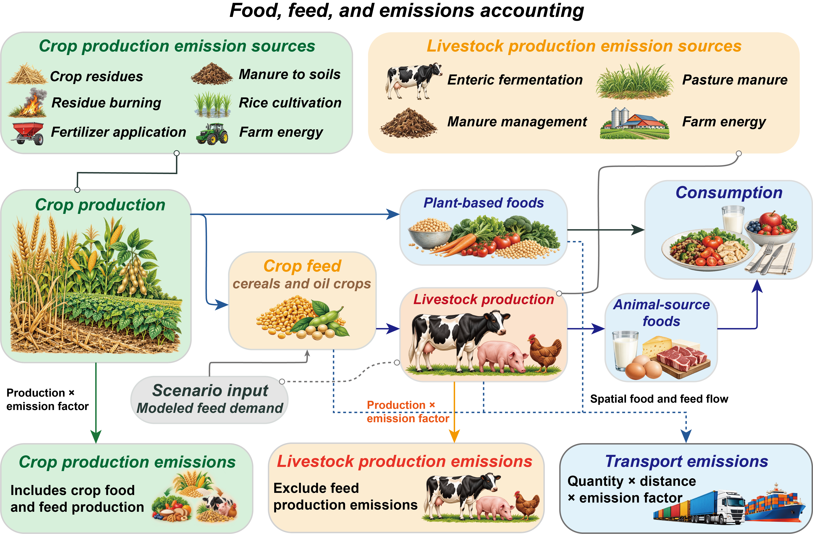
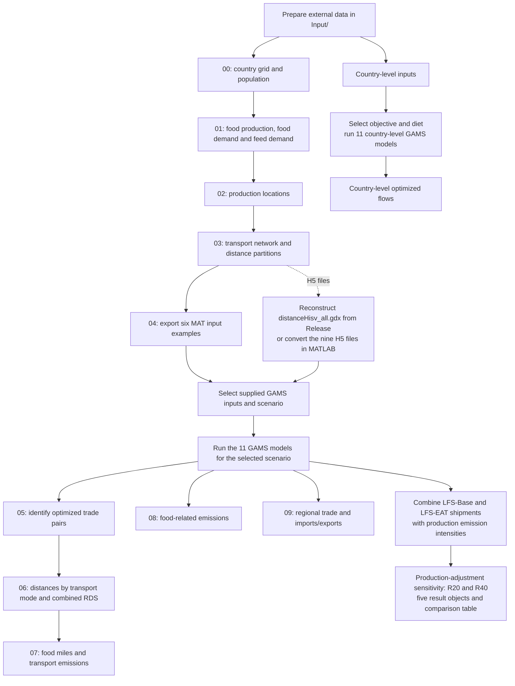
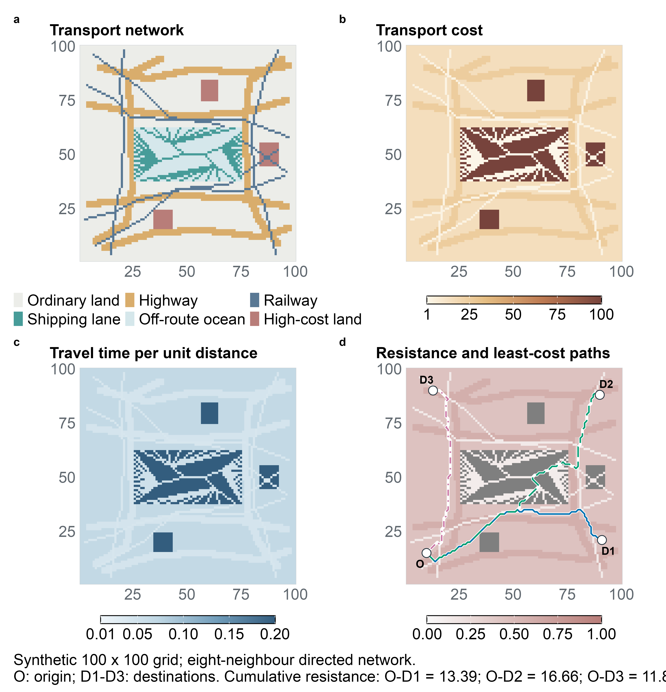
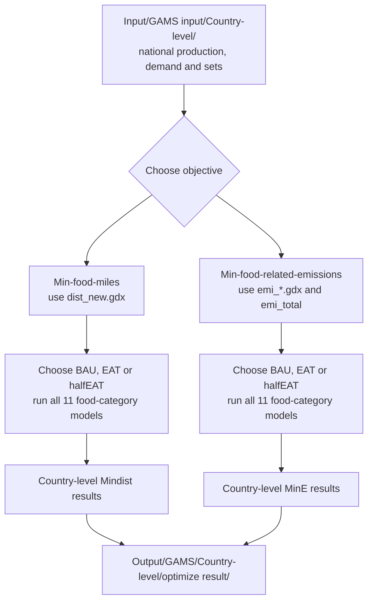

# *Lower global food system emissions via integrating dietary transition and localized food supply*

Zhongci Deng<sup>1,8</sup>, Cai Li<sup>2,8</sup>, Yuanchao Hu<sup>3</sup>, Prajal Pradhan<sup>4,5</sup>, Jingyu Wang<sup>1</sup>, Guangyi Zhai<sup>1</sup>, Yi Yang<sup>6</sup>, Zhen Wang<sup>1,2,\*</sup>, Brett A Bryan<sup>7</sup>

<sup>1</sup> College of Resources and Environment, Huazhong Agricultural University, Wuhan 430070, China.<br> <sup>2</sup> College of Public Administration, Huazhong Agricultural University, Wuhan 430070, China.<br> <sup>3</sup> School of Ecology, Environment & Resources, Guangdong University of Technology, Guangzhou 510006, China.<br> <sup>4</sup> Integrated Research on Energy, Environment, and Society (IREES), Energy and Sustainability Research Institute Groningen, University of Groningen, Groningen, 9747 AG, Netherlands.<br> <sup>5</sup> Potsdam Institute for Climate Impact Research (PIK), Member of the Leibniz Association, P.O. Box 60 12 03, D-14412 Potsdam, Germany.<br> <sup>6</sup> Key Laboratory of the Three Gorges Reservoir Region’s Eco-Environment, Ministry of Education, Chongqing University, Chongqing 400044, China.<br> <sup>7</sup> School of Life and Environmental Sciences, Deakin University, Melbourne, Vic, Australia.

<sup>8</sup> These authors contributed equally.

**Corresponding author:** Zhen Wang — [sinoo\@mail.hzau.edu.cn](mailto:sinoo@mail.hzau.edu.cn)

## Contents

- [1. Overview](#1-overview)
  - [1.1. Model scope and scenarios](#11-model-scope-and-scenarios)
  - [1.2. Emissions accounting boundary](#12-emissions-accounting-boundary)
- [2. Software environment](#2-software-environment)
  - [2.1. Optimization environment](#21-optimization-environment)
  - [2.2. R environment](#22-r-environment)
  - [2.3. MATLAB interface](#23-matlab-interface)
- [3. Data preparation](#3-data-preparation)
  - [3.1. Livestock Production Systems data](#31-livestock-production-systems-data)
    - [3.1.1. Livestock production data](#311-livestock-production-data)
    - [3.1.2. Grain-based feed consumption data](#312-grain-based-feed-consumption-data)
    - [3.1.3. Data preparation instructions](#313-data-preparation-instructions)
  - [3.2. SPAM crop production data](#32-spam-crop-production-data)
    - [3.2.1. Data used in this study](#321-data-used-in-this-study)
    - [3.2.2. Data preparation instructions](#322-data-preparation-instructions)
    - [3.2.3. Version and reproducibility](#323-version-and-reproducibility)
  - [3.3. Gridded Population of the World (GPWv4) population data](#33-gridded-population-of-the-world-gpwv4-population-data)
    - [3.3.1. Data used in this study](#331-data-used-in-this-study)
    - [3.3.2. Data preparation instructions](#332-data-preparation-instructions)
    - [3.3.3. Version and reproducibility](#333-version-and-reproducibility)
  - [3.4. Transportation networks](#34-transportation-networks)
    - [3.4.1. GRIP4 road density data](#341-grip4-road-density-data)
      - [3.4.1.1. Dataset information](#3411-dataset-information)
      - [3.4.1.2. Data used in this study](#3412-data-used-in-this-study)
      - [3.4.1.3. Expected files](#3413-expected-files)
      - [3.4.1.4. Data preparation instructions](#3414-data-preparation-instructions)
      - [3.4.1.5. Reference](#3415-reference)
    - [3.4.2. Global Shipping Lanes data](#342-global-shipping-lanes-data)
      - [3.4.2.1. Dataset information](#3421-dataset-information)
      - [3.4.2.2. Data used in this study](#3422-data-used-in-this-study)
      - [3.4.2.3. Data preparation instructions](#3423-data-preparation-instructions)
      - [3.4.2.4. Processing in the transportation network](#3424-processing-in-the-transportation-network)
      - [3.4.2.5. Reference](#3425-reference)
  - [3.5. GADM administrative boundary data](#35-gadm-administrative-boundary-data)
    - [3.5.1. Data used in this study](#351-data-used-in-this-study)
    - [3.5.2. Data preparation instructions](#352-data-preparation-instructions)
    - [3.5.3. Download using GitHub CLI](#353-download-using-github-cli)
    - [3.5.4. Data organization](#354-data-organization)
- [4. Code and reproducibility](#4-code-and-reproducibility)
  - [4.1. Original code archive for verification](#41-original-code-archive-for-verification)
  - [4.2. Repository guide and correspondence to supplementary materials](#42-repository-guide-and-correspondence-to-supplementary-materials)
- [5. Software requirements](#5-software-requirements)
- [6. Data availability](#6-data-availability)
  - [6.1. Large GAMS input dataset](#61-large-gams-input-dataset)
  - [6.2. Step 1. Download the GDX dataset](#62-step-1-download-the-gdx-dataset)
    - [6.2.1. Option A. Manual download (Windows, macOS, and Linux)](#621-option-a-manual-download-windows-macos-and-linux)
    - [6.2.2. Option B. Download using GitHub CLI (Windows, macOS, and Linux)](#622-option-b-download-using-github-cli-windows-macos-and-linux)
  - [6.3. Step 2. Reconstruct the original GDX file](#63-step-2-reconstruct-the-original-gdx-file)
    - [6.3.1. Option A. macOS and Linux](#631-option-a-macos-and-linux)
    - [6.3.2. Option B. Windows (PowerShell)](#632-option-b-windows-powershell)
  - [6.4. Step 3. Verify data integrity](#64-step-3-verify-data-integrity)
    - [6.4.1. Option A. macOS](#641-option-a-macos)
    - [6.4.2. Option B. Linux](#642-option-b-linux)
    - [6.4.3. Option C. Windows (PowerShell)](#643-option-c-windows-powershell)
  - [6.5. Step 4. Use the reconstructed dataset in GAMS](#65-step-4-use-the-reconstructed-dataset-in-gams)
  - [6.6. Additional data and reproducibility information](#66-additional-data-and-reproducibility-information)
  - [6.7. Cereal optimization output example](#67-cereal-optimization-output-example)
    - [6.7.1. Download and reconstruct the example](#671-download-and-reconstruct-the-example)
    - [6.7.2. Inspect and use the result](#672-inspect-and-use-the-result)
- [7. How to run the code](#7-how-to-run-the-code)
  - [7.1. Workflow](#71-workflow)
  - [7.2. Prepare the working directory and software](#72-prepare-the-working-directory-and-software)
  - [7.3. Run preprocessing](#73-run-preprocessing)
  - [7.4. Prepare GAMS inputs and run optimization](#74-prepare-gams-inputs-and-run-optimization)
    - [7.4.1. Validation of transport-network path selection](#741-validation-of-transport-network-path-selection)
  - [7.5. Model dimensions and optimization results](#75-model-dimensions-and-optimization-results)
  - [7.6. Run *LFS-Base* post-processing](#76-run-lfs-base-post-processing)
  - [7.7. Run country-level sensitivity analyses](#77-run-country-level-sensitivity-analyses)
  - [7.8. Run production-adjustment sensitivity analyses (R20 and R40)](#78-run-production-adjustment-sensitivity-analyses-r20-and-r40)
- [8. Citation](#8-citation)
- [9. License](#9-license)

## 1. Overview

This repository provides the code and supporting materials for reproducing the analyses presented in the manuscript *Lower global food system emissions via integrating dietary transition and localized food supply*.

The study combines spatial optimization, transport-network analysis and greenhouse gas (GHG) accounting to assess how localized food supply and dietary transition affect food miles, on-farm production emissions and transport emissions. The grid-level analysis represents 2020 at 30-arcmin (0.5°) resolution and covers 11 food categories.

### 1.1. Model scope and scenarios

The optimization allocates food from production cells to demand cells. Spatial production availability is held fixed as an **upper bound**, while realized production is the sum of optimized shipments from each origin. Demand must be satisfied in full, and shipments are nonnegative. Exports and sourcing patterns are model outputs. The optimized allocations are theoretical counterfactuals, rather than forecasts of observed trade.

| Scenario or scenario family | Objective and demand | Reproduction entry point |
|----|----|----|
| *LFS-Base* | Minimize food miles under baseline dietary demand | `Code/LFS-Base/` |
| *LFS-EAT* | Minimize food miles under EAT-Lancet dietary demand | `Code/LFS-EAT/` |
| *LFS-halfEAT* | Minimize food miles under 50% convergence towards EAT-Lancet demand | `Code/LFS-halfEAT/` |
| *MinE-Base*, *MinE-EAT*, *MinE-halfEAT* | Minimize on-farm food-related emissions under the corresponding dietary demands | `Code/Min-Base/`, `Code/Min-EAT/`, `Code/Min-halfEAT/` |
| Country-level counterparts | Test the same objectives and dietary alternatives using national inputs | `Code/Country-level/`; Section 7.7 |
| *LFS-EATR20*, *LFS-EATR40* | Retain 20% or 40% of the cell- and food-specific production reduction from *LFS-Base* to *LFS-EAT* | `Code/Production adjustment/`; Section 7.8 |

The manuscript's *Baseline* is a separately constructed reference, not the optimized *LFS-Base* scenario. Names such as `BAU`, `bau` and `disHarv` in the grid-level post-processing code refer to *LFS-Base* results. The `Min-*` directory names correspond to the manuscript's *MinE-* scenarios.

The core scenarios and the minimum-emission and half-EAT alternatives assume full production adjustment: unused production availability generates no production emissions. The R20/R40 sensitivity analysis relaxes this assumption without changing optimized demand or shipments. Food miles are quantity × distance, expressed as tonne-kilometres after the appropriate mass conversion; they include modeled food and feed movements and intra-cell transport.

### 1.2. Emissions accounting boundary

The accounting covers **on-farm crop and livestock production emissions and transport emissions associated with modeled food and feed flows**. Food-related emissions refer to on-farm production emissions. In the full-adjustment scenarios, these emissions are attributed to consumption through optimized flows; transport emissions are calculated separately. The production-adjustment sensitivity analysis adds retained-production emissions to the production country, as explained in Section 7.8. The sum of food-related and transport emissions represents the combined emissions within this boundary, rather than a full food-system life-cycle footprint.



*Food, feed and emissions accounting framework (Supplementary Figure 2). Crop and livestock production emissions are calculated as production quantities multiplied by the corresponding emission intensities. Transport emissions are calculated as transported quantities multiplied by mode-specific distances and emission factors.*

- **Crop production:** Includes crop residues, residue burning, synthetic fertilizer application, manure applied to soils, rice cultivation and on-farm energy use. Crop emission intensities are applied to both food and modeled feed quantities for cereals and oil crops.
- **Livestock production:** Includes enteric fermentation, manure management, manure left on pasture and on-farm energy use. Livestock emission intensities exclude feed-crop production emissions, which are counted in the crop component to avoid double counting.
- **Transport:** Covers modeled food and feed movements by road, rail and sea, excluding air transport. Food- and mode-specific factors distinguish ambient from temperature-controlled transport (Supplementary Tables 1–2).

The boundary excludes land-use change, food and feed processing, packaging, retail, household storage and preparation, and waste disposal. Transport accounting also excludes intermediate handling, stationary cold storage and duration-dependent food losses. The consumption endpoint indicates where production emissions are attributed; it does not add household consumption-stage emissions. Production-emission categories and allocation methods are documented in Supplementary Tables 12–14.

## 2. Software environment

### 2.1. Optimization environment

The optimization models were implemented in GAMS and solved as linear programs. The principal computational environment is summarized below.

| Component | Recorded configuration |
|----|----|
| GAMS | 41.4.0 |
| Optimization solver | IBM ILOG CPLEX 22.1.0.0 |
| Operating platform | 64-bit Microsoft Windows, x86-64 |
| Processor configuration | 2 sockets, 256 cores and 512 available hardware threads |
| Model formulation | Continuous linear programming |

Thread allocation varies among archived runs and is documented in the individual logs. Available hardware threads describe the server configuration rather than the number used by every optimization. The current GAMS scripts specify their solver and thread options explicitly.

### 2.2. R environment

R is used for data preprocessing, spatial analysis and post-processing. The software and package versions are listed below.

| Component        | Version or platform      |
|------------------|--------------------------|
| R                | 4.4.2 (2024-10-31)       |
| Operating system | 64-bit Microsoft Windows |
| Architecture     | x86-64                   |

| R package  | Installed version |
|------------|-------------------|
| `Matrix`   | 1.7.1             |
| `R.matlab` | 3.7.0             |
| `dplyr`    | 1.1.4             |
| `gdxrrw`   | 1.0.10            |
| `igraph`   | 2.2.1             |
| `openxlsx` | 4.2.7.1           |
| `raster`   | 3.6.32            |
| `readxl`   | 1.4.3             |
| `sf`       | 1.0.23            |
| `terra`    | 1.8.86            |
| `tidyr`    | 1.3.1             |

The scripts also require `geosphere`, `pbapply` and `rhdf5`, which must be installed before running the corresponding distance and HDF5 processing scripts. `rhdf5` is distributed through Bioconductor.

The R–GAMS interface requires `gdxrrw` and an accessible GAMS GDX library. Initialize the interface with the system directory of the installed GAMS distribution:

``` r
library(gdxrrw)
igdx("/path/to/GAMS/system/directory")
```

To record the R environment used for a reproduction run, execute:

``` r
sessionInfo()
```

### 2.3. MATLAB interface

The optional H5-to-GDX conversion uses MATLAB and the GAMS MATLAB interface providing `wgdx`. Add the interface directory to the MATLAB path before running `Code/03_build resistence GAMS file.m`. The released distance GDX can be used directly to bypass this conversion.

## 3. Data preparation

### 3.1. Livestock Production Systems data

The spatially explicit livestock production and grain-based feed consumption data were obtained from the **Livestock Production Systems** dataset available through the CSIRO Data Access Portal.

**Data source:**

[Livestock Production Systems — CSIRO Data Access Portal](https://data.csiro.au/collection/csiro:29893)

To reproduce the analysis, download the following 14 ZIP archives, comprising seven livestock production datasets and seven grain-based feed consumption datasets.

#### 3.1.1. Livestock production data

Download the following seven files:

1.  `bvmeat_kg.zip`
2.  `bvmilk_kg.zip`
3.  `pimeat_kg.zip`
4.  `poeggs_kg.zip`
5.  `pomeat_kg.zip`
6.  `sgmeat_kg.zip`
7.  `sgmilk_kg.zip`

These datasets provide spatially explicit livestock production information for the corresponding livestock product categories.

#### 3.1.2. Grain-based feed consumption data

Download the following seven files:

1.  `bvmeat_grai.zip`
2.  `bvmilk_grai.zip`
3.  `ls_grai.zip`
4.  `pimeat_grai.zip`
5.  `po_grai.zip`
6.  `sgmeat_grai.zip`
7.  `sgmilk_grai.zip`

These datasets provide spatially explicit estimates of grain biomass consumption associated with livestock production, expressed in kg/km²/year.

#### 3.1.3. Data preparation instructions

1.  Open the [CSIRO dataset page](https://data.csiro.au/collection/csiro:29893).
2.  Download all 14 ZIP archives listed above.
3.  Extract the downloaded archives.
4.  Place the extracted files in the following directory within this repository:

`Input/Livestock Production Systems data/`

Preserve the original filenames and any required directory structure to ensure compatibility with the subsequent data-processing scripts.

### 3.2. SPAM crop production data

The spatially disaggregated crop production data were obtained from the International Food Policy Research Institute (IFPRI)'s Spatial Production Allocation Model (SPAM).

**Data source:**

[Global Spatially-Disaggregated Crop Production Statistics Data for 2020, Version 1.0 — Historical dataset record](https://cgspace.cgiar.org/items/e3cb3635-4bb7-4b88-b90d-3d1c76364f82)

**Dataset information:**

- **Dataset:** Global Spatially-Disaggregated Crop Production Statistics Data for 2020
- **Model:** Spatial Production Allocation Model (SPAM)
- **Version used in this study:** 2020 Version 1.0
- **Download year:** 2024
- **Reference year:** 2020
- **Spatial resolution:** 5 arc-minutes
- **Data provider:** International Food Policy Research Institute (IFPRI)
- **Persistent identifier:** <https://doi.org/10.7910/DVN/SWPENT>

#### 3.2.1. Data used in this study

This study uses the **crop production layers** from SPAM 2020 Version 1.0 to represent the spatial distribution of crop production.

The required inputs are the production data for the crops included in the analysis, rather than the corresponding harvested area, physical area, or yield layers.

#### 3.2.2. Data preparation instructions

1.  Open the [SPAM 2020 Version 1.0 historical dataset record](https://cgspace.cgiar.org/items/e3cb3635-4bb7-4b88-b90d-3d1c76364f82).
2.  Download the crop production data files for the crops included in this study.
3.  Extract the downloaded archives, where applicable.
4.  Place the extracted files in the following directory within this repository:

`Input/SPAM data/`

Preserve the original filenames and directory structure required by the data-processing scripts.

#### 3.2.3. Version and reproducibility

The analysis uses **SPAM 2020 Version 1.0**, downloaded in 2024. This is the version used to prepare the original analysis inputs.

The current SPAM dataset page lists Version 2.0, Release 2:

[SPAM 2020 Version 2.0, Release 2 — Current dataset record](https://doi.org/10.7910/DVN/SWPENT)

Version 2.0 should not be substituted for Version 1.0 when reproducing the original analysis, because revisions to the underlying spatial production estimates may affect the results. Users should obtain Version 1.0 from the historical dataset record linked above.

### 3.3. Gridded Population of the World (GPWv4) population data

Gridded population data were obtained from the **Gridded Population of the World, Version 4 (GPWv4)** dataset developed by the NASA Socioeconomic Data and Applications Center (SEDAC).

**Data source:**

[GPWv4 — Socioeconomic Data and Applications Center (SEDAC)](https://sedac.ciesin.columbia.edu/data/collection/gpw-v4)

#### 3.3.1. Data used in this study

This study uses gridded population data to represent the spatial distribution of population.

The archived GPWv4 Beta release provides the following population-related datasets:

- **Population Count:** <https://doi.org/10.7927/H4BG2KXS>
- **UN-Adjusted Population Count:** <https://doi.org/10.7927/H4PR7SX1>
- **Population Density:** <https://doi.org/10.7927/H46T0JKB>
- **UN-Adjusted Population Density:** <https://doi.org/10.7927/H4TH8JNR>

For population-count grids, use the **Population Count** dataset corresponding to the original input data. Do not substitute population density or UN-adjusted population count unless that is the variable used by the original analysis.

The GPWv4 Beta release is archived separately from the subsequent Version 4.0 release. The two releases differ in certain datasets and country-level population estimates.

#### 3.3.2. Data preparation instructions

1.  Open the [archived GPWv4 Beta Population Count dataset](https://doi.org/10.7927/H4BG2KXS).
2.  Download the gridded population-count data required by the analysis.
3.  Extract the downloaded archive, where applicable.
4.  Place the extracted raster files in the following directory within this repository:

`Input/Other data/population/`

Preserve the original filenames and spatial reference information required by the data-processing scripts.

#### 3.3.3. Version and reproducibility

The GPWv4 Beta release was made available before the subsequent Version 4.0 release. According to the June 2016 Version 4.0 release notes, changes included revisions to Egypt's administrative boundaries and population estimates, corrections to data integration for Panama and Poland, and the addition of new datasets.

The Beta population-count data are available through the archived DOI listed above. Users reproducing the original analysis should use the same GPWv4 release and population variable as the original input data rather than automatically substituting the later Version 4.0 release.

The release notes and information on the Beta archive are available through the [GPWv4 data documentation](https://sedac.ciesin.columbia.edu/data/collection/gpw-v4).

### 3.4. Transportation networks

Transportation network data were obtained from global road density rasters and global shipping route datasets. These data provide the spatial infrastructure information used to construct the transportation network and associated friction surfaces.

#### 3.4.1. GRIP4 road density data

The road density data were obtained from the **Global Roads Inventory Project, Version 4 (GRIP4)**.

**Data sources:**

- [GRIP global roads database — Official GLOBIO download page](https://www.globio.info/download-grip-dataset)
- [GRIP4 — PBL Data Portal](https://dataportaal.pbl.nl/GRIP4)
- [GRIP4 supplementary spatial data — Zenodo](https://doi.org/10.5281/zenodo.6420961)

##### 3.4.1.1. Dataset information

- **Dataset:** Global Roads Inventory Project, Version 4
- **Data type:** Global road density raster data
- **Spatial resolution:** 5 arc-minutes (approximately 0.083333333 degrees)
- **Spatial reference:** WGS84 geographic coordinates (latitude and longitude)
- **Unit:** Meters of road per square kilometer per grid cell
- **Road categories:** Total road network and five road types
- **Reference:** Meijer et al. (2018)

GRIP4 provides global road density rasters representing the spatial distribution of road infrastructure. The dataset includes the total road network and five road categories: highways, primary roads, secondary roads, tertiary roads, and local roads.

##### 3.4.1.2. Data used in this study

Download the six global road density raster archives from the official GRIP4 download page.

| Dataset                   | Description                                 |
|---------------------------|---------------------------------------------|
| `GRIP4_density_total.zip` | Total road density, all road types combined |
| `GRIP4_density_tp1.zip`   | Type 1: Highways                            |
| `GRIP4_density_tp2.zip`   | Type 2: Primary roads                       |
| `GRIP4_density_tp3.zip`   | Type 3: Secondary roads                     |
| `GRIP4_density_tp4.zip`   | Type 4: Tertiary roads                      |
| `GRIP4_density_tp5.zip`   | Type 5: Local roads                         |

All six datasets can be downloaded from the [official GRIP4 download page](https://www.globio.info/download-grip-dataset). Alternatively, consult the [PBL Data Portal](https://dataportaal.pbl.nl/GRIP4).

##### 3.4.1.3. Expected files

After extracting the downloaded archives, retain the following files where supplied by the dataset:

| File | Description |
|----|----|
| `GRIP4_TOTAL_DENS_m_km2.asc` | Density of all road types combined |
| `GRIP4_TP1_DENS_m_km2.asc` | Density of highways |
| `GRIP4_TP2_DENS_m_km2.asc` | Density of primary roads |
| `GRIP4_TP3_DENS_m_km2.asc` | Density of secondary roads |
| `GRIP4_TP4_DENS_m_km2.asc` | Density of tertiary roads |
| `GRIP4_TP5_DENS_m_km2.asc` | Density of local roads |
| `GRIP4_area_land_km2.asc` | Land area per 5-arcminute grid cell, in km² |
| `GRIP4_density_m_km2.lyr` | Example ArcGIS layer for road density classification |

The `.asc` files are ASCII grid rasters. The `.lyr` file is an example ArcGIS layer for visualization and is not required for numerical raster analysis.

##### 3.4.1.4. Data preparation instructions

1.  Open the [official GRIP4 download page](https://www.globio.info/download-grip-dataset).
2.  Download the six global road density raster ZIP archives listed above.
3.  Extract the downloaded archives.
4.  Place the extracted files in the following directory within this repository:

`Input/Other data/transport/`

Preserve the original filenames and raster header information. Ensure that the rasters retain their original spatial resolution and WGS84 coordinate reference.

##### 3.4.1.5. Reference

Meijer, J. R., Huijbregts, M. A. J., Schotten, C. G. J., & Schipper, A. M. (2018). Global patterns of current and future road infrastructure. *Environmental Research Letters*, 13, 064006.

<https://doi.org/10.1088/1748-9326/aabd42>

#### 3.4.2. Global Shipping Lanes data

The global shipping route data were obtained from the **Global Shipping Lanes** dataset published by Benden (2022).

**Data sources:**

- [Global Shipping Lanes — Zenodo dataset](https://doi.org/10.5281/zenodo.6361763)
- [Global Shipping Lanes — GitHub repository](https://github.com/newzealandpaul/Shipping-Lanes)

##### 3.4.2.1. Dataset information

- **Dataset:** Global Shipping Lanes
- **Author:** Benden, P.
- **Publication year:** 2022
- **Data type:** Global shipping route vector data
- **Available formats:** GeoJSON and ESRI Shapefile
- **Route categories:** Major, Middle, and Minor
- **Persistent identifier:** <https://doi.org/10.5281/zenodo.6361763>

The dataset represents global shipping lanes derived from the *Map of The World's Oceans* published by the Central Intelligence Agency (CIA) in October 2012, with subsequent corrections to the original map.

The route data contain three categories:

- **Major:** Major shipping lanes.
- **Middle:** Intermediate shipping lanes.
- **Minor:** Minor shipping lanes.

##### 3.4.2.2. Data used in this study

This study uses the vector shipping route network to represent maritime transportation corridors.

The original shipping route data are provided in vector format. For integration with the other transportation networks, the routes are converted into a standardized 5-arcminute raster network during data processing.

##### 3.4.2.3. Data preparation instructions

1.  Open the [Global Shipping Lanes dataset on Zenodo](https://doi.org/10.5281/zenodo.6361763) or the [GitHub repository](https://github.com/newzealandpaul/Shipping-Lanes).
2.  Download the shipping route dataset.
3.  Extract the downloaded archive, where applicable.
4.  Retain the original vector data, including the GeoJSON or Shapefile and its associated files.
5.  Place the extracted files in the following directory within this repository:

`Input/Other data/transport/`

Preserve the original filenames and route-type attributes, particularly the `Major`, `Middle`, and `Minor` classifications.

##### 3.4.2.4. Processing in the transportation network

The shipping route data are converted from vector features into a 5-arcminute raster network to match the spatial resolution used for the transportation analysis.

In the original transportation network construction:

- Major shipping routes are assigned a travel speed of 19 km/h.
- Middle and minor shipping routes are assigned a travel speed of 10 km/h.
- Oceanic cells outside the designated shipping routes are assigned a higher relative transport cost to discourage unrealistic off-route transport.

The rasterized shipping network is integrated with road and rail networks to construct the transportation friction surface.

##### 3.4.2.5. Reference

Benden, P. (2022). *Global Shipping Lanes* [Data set]. Zenodo.

<https://doi.org/10.5281/zenodo.6361763>

### 3.5. GADM administrative boundary data

Administrative boundary data used in the spatial analysis are provided through the **GADM (Database of Global Administrative Areas)** dataset.

**Original data source:**

[GADM — Database of Global Administrative Areas](https://gadm.org/)

To facilitate reproducibility, the GADM archive used in this study is distributed through the GitHub Release because the ZIP file exceeds GitHub's standard single-file upload limit of 100 MB.

#### 3.5.1. Data used in this study

The required archive is:

`gadm.zip`

The archive contains geographic administrative boundary data used for country-level spatial processing and related analyses.

**Download link:**

[Download GADM data from GitHub Releases](https://github.com/dengzhong/Reproduction-Package-for-dietary-transition-and-localized-food-supply-/releases/tag/distanceHisv-data-v1)

The GADM archive is provided as an additional asset in the existing `distanceHisv-data-v1` Release. It is distributed separately from the main Git repository because of its file size.

#### 3.5.2. Data preparation instructions

1.  Open the [GitHub Release page](https://github.com/dengzhong/Reproduction-Package-for-dietary-transition-and-localized-food-supply-/releases/tag/distanceHisv-data-v1).
2.  Locate the **Assets** section.
3.  Download the GADM ZIP archive (`gadm.zip`, or the asset whose filename ends with `gadm.zip`).
4.  Extract the downloaded archive.
5.  Place the extracted files in the following directory within this repository:

`Input/Other data/countrylevel/`

Preserve the original filenames and associated spatial data files. The extracted data should be placed directly in the designated directory, without introducing unnecessary additional folder levels.

#### 3.5.3. Download using GitHub CLI

Users with GitHub CLI installed can also download the GADM archive directly from the existing Release:

``` bash
gh release download distanceHisv-data-v1 \
  --repo "dengzhong/Reproduction-Package-for-dietary-transition-and-localized-food-supply-" \
  --pattern "*gadm.zip" \
  --dir "gadm_download"
```

This command downloads only the GADM archive matching the specified filename pattern, rather than downloading the entire Release.

After downloading, extract the archive into:

`Input/Other data/countrylevel/`

For private repositories, appropriate GitHub authentication and repository access permissions are required.

#### 3.5.4. Data organization

After completing the preceding data preparation steps, the input directories should follow this structure:

``` text
Input/
├── GAMS input/
├── Livestock Production Systems data/
│   └── [Extracted livestock and feed data]
├── SPAM data/
│   └── [SPAM 2020 Version 1.0 crop production data]
└── Other data/
    ├── countrylevel/
    │   └── [Extracted GADM administrative boundary data]
    ├── population/
    │   └── [GPWv4 population raster data]
    └── transport/
        ├── [GRIP4 road density data]
        └── [Global Shipping Lanes data]
```

The downloaded datasets should retain the filenames and directory structures expected by the corresponding data-processing scripts.

## 4. Code and reproducibility

Parameter definitions, input fields, identifiers, units and output structures are documented in the [parameter descriptions and data dictionary](Documentation/README.md).

The computational framework primarily uses **R and GAMS** for data processing, spatial analysis, optimization, emission accounting, and visualization.

The main analytical procedures include:

1.  **Data preparation:** Processing spatially explicit food production, consumption, population, administrative boundaries, and emission datasets.
2.  **Transportation network construction:** Constructing transportation resistance surfaces and estimating transport distances using road, rail, and shipping networks.
3.  **Spatial optimization:** Optimizing food allocation between production and consumption locations under different dietary and food supply scenarios.
4.  **GHG emission accounting:** Quantifying on-farm agricultural production emissions and transportation emissions associated with optimized food flows.
5.  **Results and visualization:** Analyzing scenario outcomes and generating the figures and supporting results.

The analyses examine the localized food supply strategy under baseline dietary demands (*LFS-Base*) and its integration with the EAT-Lancet dietary transition (*LFS-EAT*).

### 4.1. Original code archive for verification

For transparency and ease of verification, the **original source code** used in the study has been archived on Figshare:

[**Original source code on Figshare**](https://doi.org/10.6084/m9.figshare.28448249)

This archive is provided to allow reviewers and interested researchers to directly compare the original implementation with the organized code presented in this GitHub repository.

### 4.2. Repository guide and correspondence to supplementary materials

| Location | Contents |
|----|----|
| `Code/` | Preprocessing, grid-level and country-level optimization models, post-processing and production-adjustment sensitivity analysis |
| `Input/` | Supplied model inputs, national statistics, lookups and locations for external datasets |
| `Output/` | Spatial intermediates, optimization results, archived solver logs and post-processing outputs |
| `Demo/` | Synthetic transport-network validation script, figure and numerical checks |
| [Documentation/README.md](Documentation/README.md) | Parameter descriptions, data dictionary, identifiers and unit conventions |
| [diagram.png](diagram.png) | Food/feed flows and emissions accounting boundary |

The following entries connect the workflow to the revised Supplementary Information:

| Supplementary item | Repository material or workflow |
|----|----|
| Figure 2: accounting boundary | `diagram.png`; Section 1.2 |
| Figure 11: simple transport-network validation test | `Demo/transport_network_demo.R`; Section 7.4.1 |
| Table 8: grid-level scenario emissions | Scenario models in Section 7.4 and scenario-specific post-processing based on Section 7.6 |
| Table 10: country-level scenario emissions | Country-level models and analysis described in Section 7.7 |
| Table 11: incomplete production adjustment | `Code/Production adjustment/production_adjustment_sensitivity.R`; `emissions_comparison_table` in Section 7.8 |

Scripts `07`–`09` provide spatial and tabular results for food miles, emissions and trade analyses. The numbered post-processing scripts are configured for *LFS-Base*; reproducing other scenarios requires the corresponding input filenames and output paths. They do not automatically render every publication figure or assemble every supplementary table. Large files distributed through Releases must be reconstructed separately, as described in Section 6.

## 5. Software requirements

The main software environments used in this study include:

- **R:** Spatial data processing, transportation network analysis, emission calculations, and visualization.
- **GAMS:** Mathematical programming and spatial optimization.
- **CPLEX:** Linear programming solver used for the optimization models.

Additional tools for accessing and reconstructing the large input datasets include:

- **GitHub CLI (gh):** Downloading large dataset files from GitHub Releases.
- **macOS/Linux terminal or Windows PowerShell:** Reconstructing the original GDX file and verifying data integrity.
- **Archive extraction software:** Extracting ZIP archives containing external input datasets.

Additional R package dependencies and implementation details can be identified from the corresponding scripts.

## 6. Data availability

The analyses draw on spatially explicit agricultural production, food consumption, population, administrative boundaries, transportation networks, and GHG emission datasets.

The livestock production and grain-based feed consumption data are available through the [CSIRO Data Access Portal](https://data.csiro.au/collection/csiro:29893). The crop production data used in this study are from SPAM 2020 Version 1.0. Gridded population data are available through the archived GPWv4 dataset records. Road density and shipping route data are available through the GRIP4 and Global Shipping Lanes datasets, respectively.

Large input files that exceed GitHub's standard single-file size limit are distributed through the existing GitHub Release:

[Large input datasets — GitHub Releases](https://github.com/dengzhong/Reproduction-Package-for-dietary-transition-and-localized-food-supply-/releases/tag/distanceHisv-data-v1)

These include the GAMS distance dataset `distanceHisv_all.gdx` and the GADM administrative boundary archive `gadm.zip`.

### 6.1. Large GAMS input dataset

**Dataset:** `distanceHisv_all.gdx`

**File format:** GAMS Data Exchange (GDX)

**Original file size:** Approximately 17 GB

**Storage location:** GitHub Releases

**Release version:** `distanceHisv-data-v1`

**Download link:**

[Download the complete GAMS input dataset](https://github.com/dengzhong/Reproduction-Package-for-dietary-transition-and-localized-food-supply-/releases/tag/distanceHisv-data-v1)

Because the original dataset exceeds GitHub's individual file size limits, it has been divided into 11 consecutive parts without modifying the underlying binary data.

The GDX-specific files in the Release are:

| File                            | Description                               |
|---------------------------------|-------------------------------------------|
| `distanceHisv_all.gdx.part-aaa` | Data part 1                               |
| `distanceHisv_all.gdx.part-aab` | Data part 2                               |
| `distanceHisv_all.gdx.part-aac` | Data part 3                               |
| `distanceHisv_all.gdx.part-aad` | Data part 4                               |
| `distanceHisv_all.gdx.part-aae` | Data part 5                               |
| `distanceHisv_all.gdx.part-aaf` | Data part 6                               |
| `distanceHisv_all.gdx.part-aag` | Data part 7                               |
| `distanceHisv_all.gdx.part-aah` | Data part 8                               |
| `distanceHisv_all.gdx.part-aai` | Data part 9                               |
| `distanceHisv_all.gdx.part-aaj` | Data part 10                              |
| `distanceHisv_all.gdx.part-aak` | Data part 11                              |
| `SHA256SUMS.txt`                | SHA-256 checksum of the original GDX file |

Together, the 11 parts contain the complete original dataset. They can be concatenated in filename order to reconstruct the original GDX file without any loss or modification of data.

**Important:** GitHub Release assets are stored separately from the repository's source files and are not automatically downloaded when cloning the repository using `git clone`.

While the repository remains private, access to these assets requires appropriate GitHub repository permissions.

### 6.2. Step 1. Download the GDX dataset

The complete GDX dataset can be downloaded manually from the GitHub Release page or automatically using GitHub CLI.

#### 6.2.1. Option A. Manual download (Windows, macOS, and Linux)

1.  Open the [GitHub Release page](https://github.com/dengzhong/Reproduction-Package-for-dietary-transition-and-localized-food-supply-/releases/tag/distanceHisv-data-v1).
2.  Locate the **Assets** section.
3.  Download all 11 files named `distanceHisv_all.gdx.part-aaa` through `distanceHisv_all.gdx.part-aak`.
4.  Download `SHA256SUMS.txt`.
5.  Save these 12 files in the same folder.

All 11 data parts are required to reconstruct the original GDX file.

#### 6.2.2. Option B. Download using GitHub CLI (Windows, macOS, and Linux)

Install GitHub CLI if it is not already available:

<https://cli.github.com/>

Authenticate with GitHub if necessary:

``` bash
gh auth login
```

Then execute:

``` bash
gh release download distanceHisv-data-v1 \
  --repo "dengzhong/Reproduction-Package-for-dietary-transition-and-localized-food-supply-" \
  --pattern "distanceHisv_all.gdx.part-*" \
  --pattern "SHA256SUMS.txt" \
  --dir "distanceHisv_release_parts"
```

This command downloads only the 11 GDX data parts and their checksum file into the `distanceHisv_release_parts` directory.

Other Release assets, such as `gadm.zip`, are not downloaded by this command.

### 6.3. Step 2. Reconstruct the original GDX file

The 11 downloaded parts must be combined in alphabetical order to restore the original `distanceHisv_all.gdx`.

#### 6.3.1. Option A. macOS and Linux

Open a terminal and navigate to the folder containing the downloaded files:

``` bash
cd distanceHisv_release_parts
```

Reconstruct the original file:

``` bash
cat distanceHisv_all.gdx.part-* > distanceHisv_all.gdx
```

This command concatenates the 11 binary parts in filename order and generates `distanceHisv_all.gdx`.

#### 6.3.2. Option B. Windows (PowerShell)

Open Windows PowerShell and navigate to the directory containing the downloaded files:

``` powershell
cd "distanceHisv_release_parts"
```

Run:

``` powershell
$parts = @(Get-ChildItem -File -Filter "distanceHisv_all.gdx.part-*" | Sort-Object Name)

if ($parts.Count -ne 11) {
    throw "Expected 11 data parts, but found $($parts.Count)."
}

$output = Join-Path (Get-Location) "distanceHisv_all.gdx"

$destination = [System.IO.File]::Open(
    $output,
    [System.IO.FileMode]::CreateNew
)

try {
    foreach ($part in $parts) {
        Write-Host "Merging $($part.Name)..."

        $source = [System.IO.File]::OpenRead($part.FullName)

        try {
            $source.CopyTo($destination)
        }
        finally {
            $source.Dispose()
        }
    }
}
finally {
    $destination.Dispose()
}

Write-Host "GDX file reconstruction completed."
```

This procedure combines the files sequentially as binary data without loading the entire 17 GB dataset into memory. It also prevents accidental overwriting of an existing reconstructed file.

Ensure that sufficient free disk space is available before reconstruction. Approximately 17 GB of additional storage is required for the reconstructed file.

### 6.4. Step 3. Verify data integrity

A SHA-256 checksum is provided to verify that the reconstructed GDX file is byte-for-byte identical to the original dataset.

The expected SHA-256 checksum is:

``` text
3b862d64f9fddb82f1f1db5025aa97822be2be27d73d893e05f23de9186eadda
```

#### 6.4.1. Option A. macOS

In the directory containing the reconstructed GDX file and `SHA256SUMS.txt`, execute:

``` bash
shasum -a 256 -c SHA256SUMS.txt
```

#### 6.4.2. Option B. Linux

Execute:

``` bash
sha256sum -c SHA256SUMS.txt
```

If the file has been reconstructed correctly, the output should be:

``` text
distanceHisv_all.gdx: OK
```

#### 6.4.3. Option C. Windows (PowerShell)

Open PowerShell in the directory containing the reconstructed GDX file and `SHA256SUMS.txt`.

Execute:

``` powershell
$expected = ((Get-Content "SHA256SUMS.txt" -TotalCount 1) -split '\s+')[0].ToLowerInvariant()

$actual = (Get-FileHash "distanceHisv_all.gdx" -Algorithm SHA256).Hash.ToLowerInvariant()

if ($actual -eq $expected) {
    Write-Host "SHA-256 verification: OK"
}
else {
    throw "SHA-256 verification failed."
}
```

If verification is successful, PowerShell will display:

``` text
SHA-256 verification: OK
```

A matching checksum confirms that the reconstructed file is identical to the original GDX file. If verification fails, check that all 11 parts were downloaded completely and concatenated in the correct order.

### 6.5. Step 4. Use the reconstructed dataset in GAMS

After successful reconstruction and verification, the file `distanceHisv_all.gdx` can be used as an input dataset for the corresponding GAMS spatial optimization models.

Place the reconstructed file in the expected input directory or adjust the file paths in the GAMS scripts accordingly.

The GDX format is supported by GAMS and can be inspected using GAMS-compatible tools.

### 6.6. Additional data and reproducibility information

The original source code and additional methodological information are available through the Figshare archive:

<https://doi.org/10.6084/m9.figshare.28448249>

The data sources, assumptions, and analytical procedures are further documented in the manuscript and its Supplementary Information.

This GitHub repository provides organized code and supporting materials to facilitate examination and reproduction of the analytical framework, while the Figshare archive preserves the original implementation for direct comparison and verification.

### 6.7. Cereal optimization output example

The worked example `cereal_disHarv.gdx` contains the archived *LFS-Base* cereal optimization result. It is an **output** for inspection and post-processing, rather than a production, demand or distance input for rerunning optimization. The file contains the optimized shipment variable `x` and the distance parameter `distances`. Production and demand sets are supplied separately in `Input/GAMS input/`.

#### 6.7.1. Download and reconstruct the example

Download the following eight parts and the separate checksum file from the [existing GitHub Release](https://github.com/dengzhong/Reproduction-Package-for-dietary-transition-and-localized-food-supply-/releases/tag/distanceHisv-data-v1):

``` text
cereal_disHarv.gdx.part-aaa
cereal_disHarv.gdx.part-aab
cereal_disHarv.gdx.part-aac
cereal_disHarv.gdx.part-aad
cereal_disHarv.gdx.part-aae
cereal_disHarv.gdx.part-aaf
cereal_disHarv.gdx.part-aag
cereal_disHarv.gdx.part-aah
cereal_SHA256SUMS.txt
```

Using GitHub CLI:

``` bash
gh release download distanceHisv-data-v1 \
  --repo "dengzhong/Reproduction-Package-for-dietary-transition-and-localized-food-supply-" \
  --pattern "cereal_disHarv.gdx.part-*" \
  --pattern "cereal_SHA256SUMS.txt" \
  --dir "cereal_release_parts"
```

On macOS or Linux, reconstruct and verify the file in the download directory:

``` bash
cd cereal_release_parts
cat cereal_disHarv.gdx.part-* > cereal_disHarv.gdx
# macOS
shasum -a 256 -c cereal_SHA256SUMS.txt
# Linux alternative
sha256sum -c cereal_SHA256SUMS.txt
```

The expected SHA-256 checksum is:

``` text
bf5ea55f2723f0ae7bff4ce708c51468a46ad72f2510a2a4f4c2284591a5115f
```

Successful verification reports `cereal_disHarv.gdx: OK`. The cereal files are independent of the `distanceHisv_all.gdx.part-*` files; reconstruct each dataset using only its own parts and checksum.

On Windows, use PowerShell to concatenate the eight binary parts:

``` powershell
cd "cereal_release_parts"
$parts = @(Get-ChildItem -File -Filter "cereal_disHarv.gdx.part-*" | Sort-Object Name)
if ($parts.Count -ne 8) { throw "Expected eight cereal data parts." }
$destination = [System.IO.File]::Open(
    (Join-Path (Get-Location) "cereal_disHarv.gdx"),
    [System.IO.FileMode]::CreateNew
)
try {
    foreach ($part in $parts) {
        $source = [System.IO.File]::OpenRead($part.FullName)
        try { $source.CopyTo($destination) }
        finally { $source.Dispose() }
    }
}
finally { $destination.Dispose() }
$expected = ((Get-Content "cereal_SHA256SUMS.txt" -TotalCount 1) -split '\s+')[0].ToLowerInvariant()
$actual = (Get-FileHash "cereal_disHarv.gdx" -Algorithm SHA256).Hash.ToLowerInvariant()
if ($actual -ne $expected) { throw "Cereal checksum verification failed." }
Write-Host "cereal_disHarv.gdx: OK"
```

Place the verified file at:

``` text
Output/GAMS/optimize result/cereal_disHarv.gdx
```

#### 6.7.2. Inspect and use the result

Open the reconstructed file with a GAMS-compatible GDX viewer to inspect `x` and `distances`. In R, initialize `gdxrrw` and inspect the available symbols without loading the complete shipment matrix:

``` r
library(gdxrrw)
igdx("/path/to/GAMS/system/directory")
result_file <- "Output/GAMS/optimize result/cereal_disHarv.gdx"
info <- gdxInfo(result_file, dump = FALSE, returnDF = TRUE)
info$variables
info$parameters
```

Variable `x(i,j)` represents the optimized cereal quantity shipped from origin `i` to destination `j`. Its level field, `l`, contains shipment quantities; `distances(i,j)` provides the corresponding modeled distances. Preserve the original GAMS labels when matching these records to the supplied production and demand data.

For an initial inspection of a restricted shipment subset:

``` r
labels <- rgdx(result_file)$uels
origins <- head(labels[grepl("^i[0-9]+$", labels)], 1)
destinations <- head(labels[grepl("^j[0-9]+$", labels)], 5)
shipment_subset <- rgdx(result_file,
                       list(name = "x", field = "l", uels = list(origins, destinations)))
shipment_subset$uels
shipment_subset$val
```

The index columns in `val` refer to the returned `uels` lists. Sparse reads omit zero levels by default, so a selected subset may contain no positive shipments. The file is large; use symbol inspection or filtered reads before loading a complete matrix.

The verified example can replace a new cereal solve when examining its optimized shipments or carrying out cereal-specific post-processing. Scripts `05`, `07`, `08` and `09` read the cereal file from the location above as part of their 11-category workflows. Running those scripts unchanged also requires the other food-category results and their documented preprocessing inputs. Script `06` additionally depends on `source_all.rds` generated by script `05`.

## 7. How to run the code

### 7.1. Workflow



The numbered R post-processing scripts currently read *LFS-Base* results. Other scenarios require corresponding result filenames and separate post-processing output paths. The GAMS scenarios are independent alternatives, not consecutive steps.

### 7.2. Prepare the working directory and software

Run R from the repository root, which contains `Code/`, `Input/` and `Output/`. For example:

``` r
setwd("/path/to/Reproduction-Package")
```

Prepare the external datasets described in Section 3 and retain the supplied supporting inputs. The country-to-region lookup is `Input/Other data/mapping country and region.xlsx`. Install the R packages loaded at the start of each script. Reading GDX files requires the GAMS GDX library and `gdxrrw`; initialize the interface before running the post-processing scripts:

``` r
library(gdxrrw)
igdx("/path/to/GAMS/system/directory")
```

Before starting, choose the spatial resolution, dietary scenario and optimization objective. There are two supported entry points: (1) run the R preprocessing to rebuild spatial intermediates, then use the supplied optimization inputs; or (2) run GAMS directly using the supplied GDX/INC files. The second entry point reproduces the optimization without rerunning the R preprocessing. For grid-level post-processing, the population, production-location and transport rasters are still required.

Keep `Input/` for supplied or downloaded data and `Output/` for generated files. Run the R commands below in the repository root, not inside `Code/`. Scripts with the same numeric prefix must all be identified by their full filenames.

The GAMS files currently contain absolute paths. Replace the project prefix `/Users/zhongcideng/Desktop/Code availability/` with the absolute path to your local repository before running them. Keep the remaining input and output subdirectories unchanged. Check the solver and thread settings in each model before execution.

### 7.3. Run preprocessing

Run the following scripts in this order. Scripts sharing the `01` prefix perform different tasks and must not be treated as interchangeable.

``` r
source("Code/00_preprocessing_basedata.R")
source("Code/01_processing_animal_based_food.R")
source("Code/01_processing_plant_based_food.R")
source("Code/01_processing_feed.R")
source("Code/01_processing_base_fooddemand.R")
source("Code/01_processing_EAT_fooddemand.R")
source("Code/01_processing_feed_EAT.R")
source("Code/02_processing_production_locations.R")
source("Code/03_build_resistence.R")
source("Code/04_food_demand_to_gams.R")
```

Each `source()` call above is a separate step. Wait for it to finish before starting the next dependent step.

| Step | R script in `Code/` | What it does and reads | Files used by the next steps |
|----|----|----|----|
| 1 | `00_preprocessing_basedata.R` | Rasterizes the supplied country boundaries and calibrates the GPW population grid to the 2020 national totals in `population_WB.xlsx`. | `Output/basedata/country_ID.tif` and `Output/0.5by0.5/calib_2020_population_0.5by0.5.tif`. |
| 2 | `01_processing_animal_based_food.R` | Reads the seven livestock-production rasters, processes bovine/sheep/goat products, and calibrates and aggregates production using `livestock.xlsx` and `livestock_new.xlsx`. It uses the country grid from Step 1. | Intermediate rasters under `Output/animal/` and calibrated animal-food production rasters under `Output/0.5by0.5/`. |
| 3 | `01_processing_plant_based_food.R` | Combines the SPAM crop-production rasters into food groups, aggregates them to 0.5 degrees and calibrates production using `crop_production_demand.xlsx`. | `Output/plant/` intermediates and calibrated plant-food production rasters under `Output/0.5by0.5/`. |
| 4 | `01_processing_feed.R` | Resamples livestock grain-feed data, calibrates total feed to 2020, separates crop and oil feed using the supplied CSV tables, and distributes feed among livestock types. | Feed intermediates under `Output/feed/` and baseline feed-demand rasters under `Output/0.5by0.5/basic_feed_demand/`. |
| 5 | `01_processing_base_fooddemand.R` | Allocates the baseline food-demand statistics to the calibrated population grid, using the crop and livestock production/demand workbooks. | `Output/0.5by0.5/basic_food_demand/`. |
| 6 | `01_processing_EAT_fooddemand.R` | Uses the calibrated population grid and `food_demand_for_lancet.xlsx` to construct EAT-Lancet food demand. | `Output/0.5by0.5/EAT_food_demand/`. |
| 7 | `01_processing_feed_EAT.R` | Uses baseline feed demand and the EAT-to-baseline animal-food demand ratios from Steps 5–6 to construct EAT feed demand. | `Output/0.5by0.5/EAT_feed_demand/`. |
| 8 | `02_processing_production_locations.R` | Combines the calibrated food-production rasters from Steps 2–3 to identify production locations shared by the optimization workflow. | `Output/0.5by0.5/calib_2020_point_production.tif`. |
| 9 | `03_build_resistence.R` | Combines road, rail and shipping inputs into the transport-speed surface. Uses the production locations and population grid to compute the nine production-to-demand H5 distance partitions. | `Output/transport/alltransport_speed_new.tif` and `Output/distances/short_Harvdis_production_demand_<first>-<last>.h5`. |
| 10 | `04_food_demand_to_gams.R` | Matches demand and production to the transport grid and exports the six implemented food/scenario MAT examples. | `vegetable_index.mat`, `cereal_index.mat`, `legume_nuts_index.mat`, `fruit_eat_index.mat`, `oilcrop_eat_index.mat` and `legume_nuts_eat_index.mat` under `Output/GAMS/`. |

The half-EAT national and grid-level demand GDX files are supplied inputs. The `01` scripts listed above do not themselves export half-EAT GDX files. Likewise, `04` does not convert every food category or scenario to GDX/INC; the supplied GAMS inputs bridge this part of the current workflow.

In `03_build_resistence.R`, select the distance partitions using `partitions_to_run`. Its default is `1:9`; completed H5 files must be excluded from subsequent runs because the script stops rather than overwriting them. These partitions are independent and must all be available for the MATLAB conversion.

### 7.4. Prepare GAMS inputs and run optimization

The supplied GDX and INC inputs are in `Input/GAMS input/`; country-level inputs are in its `Country-level/` subdirectory. `04_food_demand_to_gams.R` exports six MAT files and does **not** generate all the supplied GDX and INC files. Use the supplied inputs to reproduce the optimization runs.

For the grid-level food-miles models, reconstruct the released distance file as described in Section 6 and place it at:

``` text
Output/GAMS/distanceHisv_all.gdx
```

Alternatively, after all nine H5 partitions have been generated, run `Code/03_build resistence GAMS file.m` in MATLAB with the GAMS MATLAB API containing `wgdx` on the MATLAB path. Because this script is stored inside `Code/`, set its first line to the repository root before running it:

``` matlab
project_dir = fileparts(fileparts(mfilename('fullpath')));
```

In MATLAB, add the GAMS API and run the conversion script, for example:

``` matlab
addpath('/path/to/GAMS/system/directory');
run('/path/to/Reproduction-Package/Code/03_build resistence GAMS file.m');
```

The GAMS MATLAB interface must provide `wgdx`. The conversion reads H5 datasets `/distance_all1` through `/distance_all9`, concatenates the blocks in production-point order, and writes the parameter `distances` to `Output/GAMS/distanceHisv_all.gdx`. It does not generate the food-production or dietary-demand GDX files. When using the released distance GDX, skip the H5-to-GDX conversion; the transport-speed raster is still needed for scripts `04`–`09`.

Choose a scenario and run all 11 food-category GAMS models in its folder:

| Scenario | Folder under `Code/` | Objective | Dietary demand |
|----|----|----|----|
| *LFS-Base* | `LFS-Base/` | Minimize food miles | Baseline |
| *LFS-EAT* | `LFS-EAT/` | Minimize food miles | EAT-Lancet |
| *LFS-halfEAT* | `LFS-halfEAT/` | Minimize food miles | Half-EAT |
| *MinE-Base* | `Min-Base/` | Minimize food-related emissions | Baseline |
| *MinE-EAT* | `Min-EAT/` | Minimize food-related emissions | EAT-Lancet |
| *MinE-halfEAT* | `Min-halfEAT/` | Minimize food-related emissions | Half-EAT |

For example, run the bovine *LFS-Base* model from a terminal with GAMS available on the command path:

``` bash
gams "Code/LFS-Base/Bovine_optimal.gms"
```

To run all 11 models in one scenario from R, execute the following **after preprocessing**. Change `scenario_dir` to the desired folder from the table above; use a fresh selection for each scenario.

``` r
gams <- Sys.which("gams")
stopifnot(nzchar(gams))  # Or assign the full path to the GAMS executable.
scenario_dir <- "Code/LFS-Base"
models <- sort(list.files(scenario_dir, pattern = "\\.gms$", full.names = TRUE))
stopifnot(length(models) == 11L)
log_dir <- file.path("Output", "GAMS", "logs", basename(scenario_dir))
dir.create(log_dir, recursive = TRUE, showWarnings = FALSE)
for (model in models) {
  listing <- file.path(normalizePath(log_dir), paste0(tools::file_path_sans_ext(basename(model)), ".lst"))
  status <- system2(gams, args = c(shQuote(normalizePath(model)), shQuote(paste0("o=", listing))))
  if (status != 0L) stop("GAMS failed: ", model)
}
```

GAMS reads each food's production and demand sets and GDX parameters. The food-miles models also read the shared `distances` parameter; the minimum-emission models read the food's production emission intensity and set `emi_total` to that intensity. Each model enforces nonnegative shipments, production-capacity upper bounds and full demand satisfaction. The resulting `x` variable records optimized shipments between production and demand locations.

Grid-level results are written to `Output/GAMS/optimize result/`:

| Scenario       | Result filename pattern           |
|----------------|-----------------------------------|
| *LFS-Base*     | `<food>_disHarv.gdx`              |
| *LFS-EAT*      | `<food>_disHarv_eat.gdx`          |
| *LFS-halfEAT*  | `<food>_halfeat_minfoodmiles.gdx` |
| *MinE-Base*    | `<food>_minEmission.gdx`          |
| *MinE-EAT*     | `<food>_eat_minEmission.gdx`      |
| *MinE-halfEAT* | `<food>_halfeat_minEmission.gdx`  |

After each solve, inspect the GAMS listing for the solver/model status and confirm that the requested optimum was obtained. A GDX file's existence alone does not establish feasibility or optimality. Proceed to post-processing only after the required 11 food-category results are available.

For the separate country-level sensitivity workflow, see Section 7.7.

#### 7.4.1. Validation of transport-network path selection

A reproducible [synthetic-network demonstration](Demo/transport_network_demo.R) verifies the increasing resistance transformation and its use in shortest-path calculation. The hypothetical 100 × 100 grid contains land corridors, railways, 20 shipping routes and high-cost cells. It uses the same normalization expressions and source-cell edge-weight construction as the transport-network scripts. The spatial arrangement and illustrative speeds are synthetic rather than observed geography.

The demonstration checks that resistance increases with relative cost at fixed travel time and with travel time at fixed cost. For three origin–destination pairs, it independently sums the source-cell resistance along each calculated path and compares the sum with the weighted shortest-path result. All three comparisons agree within the specified numerical tolerance, and none of the selected paths crosses a penalized cell.



**Supplementary Figure 11: A simple validation test of transport-network construction and least-cost path selection.** **a**, Synthetic transport network. **b**, Relative transport cost (1–100). **c**, Travel time per unit distance, calculated as inverse speed. **d**, Combined resistance surface and least-cost paths from origin O to destinations D1–D3. Background colours in panel d represent cell resistance on a displayed scale of 0–1; values above this range appear grey. Full resistance values are retained in path calculations. The annotations beneath the panels report cumulative path resistance, rather than geographic distance. The archived image and PDF retain `Supplementary_Figure_X_4panel` in their filenames.

| Route | Path cells | Cumulative resistance | Absolute verification error | Penalized cells traversed |
|----|---:|---:|---:|---:|
| O–D1 | 88 | 13.3905502392345 | 0 | 0 |
| O–D2 | 116 | 16.6587131704860 | 0 | 0 |
| O–D3 | 81 | 11.8947368421053 | 0 | 0 |

Run the demonstration from the repository root in R:

``` r
# Install once if required.
install.packages(c("igraph", "ggplot2", "Matrix", "patchwork", "scales"))
source("Demo/transport_network_demo.R")
```

The script uses the fixed seed `20261010` and writes its outputs to `Demo/`. A [PDF version](Demo/Supplementary_Figure_X_4panel.pdf) accompanies the combined image. Numerical outputs comprise:

- [Grid speed, cost and resistance](Demo/grid_speed_cost_resistance.csv): cell identifiers, coordinates, network classes and resistance inputs.
- [Route validation](Demo/route_validation.csv): cumulative resistance, independent verification errors and penalized-cell counts.
- [Calculated paths](Demo/three_shortest_paths.csv): ordered cells traversed by each route.
- [Shipping-route definitions](Demo/twenty_shipping_routes.csv): route identifiers and associated cell identifiers.

This demonstration tests resistance normalization, edge construction and path selection. Its values describe the synthetic test network rather than the global optimization results.

### 7.5. Model dimensions and optimization results

Detailed optimization records for *LFS-Base* and *LFS-EAT* are available in `Output/GAMS/logs/`. The table below summarizes model dimensions, optimization status and computational performance across the 11 food categories. Model dimensions are reported before CPLEX presolve.

| Food category | Scenario | Variables | Equations | Non-zeros | Model status | Job status | CPLEX time (s) | Total time (h) |
|---|---|---:|---:|---:|---|---|---:|---:|
| [Cereal](Output/GAMS/logs/cereal_optimal.log) | *LFS-Base* | 613,439,310 | 50,095 | 1,840,298,729 | Optimal | Normal completion | 32,771.53 | 17.003 |
| [Cereal](Output/GAMS/logs/cereal_optimal_eat.log) | *LFS-EAT* | 613,439,310 | 50,095 | 1,840,298,729 | Optimal | Normal completion | 4,808.81 | 9.274 |
| [Bovine](Output/GAMS/logs/Bovine_optimal.log) | *LFS-Base* | 862,331,583 | 58,744 | 2,586,971,250 | Optimal | Normal completion | 43,221.33 | 23.680 |
| [Bovine](Output/GAMS/logs/Bovine_optimal_eat.log) | *LFS-EAT* | 862,331,583 | 58,744 | 2,586,971,250 | Optimal | Normal completion | 3,518.02 | 13.324 |
| [Eggs](Output/GAMS/logs/eggs_optimal.log) | *LFS-Base* | 526,014,784 | 47,057 | 1,578,027,332 | Optimal | Normal completion | 8,782.20 | 5.136 |
| [Eggs](Output/GAMS/logs/eggs_optimal_eat.log) | *LFS-EAT* | 526,014,784 | 47,057 | 1,578,027,332 | Optimal | Normal completion | 45,389.81 | 15.086 |
| [Fruits](Output/GAMS/logs/fruit_optimal.log) | *LFS-Base* | 532,173,062 | 47,271 | 1,596,501,943 | Optimal | Normal completion | 10,801.20 | 5.509 |
| [Fruits](Output/GAMS/logs/fruit_optimal_eat.log) | *LFS-EAT* | 532,173,062 | 47,271 | 1,596,501,943 | Optimal | Normal completion | 19,018.78 | 7.762 |
| [Pulses](Output/GAMS/logs/legumes_nuts_optimal.log) | *LFS-Base* | 440,978,749 | 44,102 | 1,322,922,262 | Optimal | Normal completion | 1,986.12 | 2.665 |
| [Pulses](Output/GAMS/logs/legume_nuts_optimal_eat.log) | *LFS-EAT* | 440,978,749 | 44,102 | 1,322,922,262 | Optimal | Not recorded | 163,536.14 | 47.771 |
| [Milk](Output/GAMS/logs/milk_optimal.log) | *LFS-Base* | 517,928,447 | 46,776 | 1,553,769,316 | Optimal | Normal completion | 15,120.39 | 6.842 |
| [Milk](Output/GAMS/logs/milk_optimal_eat.log) | *LFS-EAT* | 517,928,447 | 46,776 | 1,553,769,316 | Optimal | Normal completion | 195,774.78 | 56.916 |
| [Oil crop](Output/GAMS/logs/oilcrop_optimal.log) | *LFS-Base* | 446,134,941 | 44,017 | 1,338,390,693 | Optimal | Normal completion | 1,115.59 | 2.562 |
| [Oil crop](Output/GAMS/logs/oilcrop_optimal_eat.log) | *LFS-EAT* | 446,134,941 | 44,017 | 1,338,390,693 | Optimal | Normal completion | 1,567.80 | 2.533 |
| [Pig](Output/GAMS/logs/pig_optimal.log) | *LFS-Base* | 300,160,561 | 37,607 | 900,470,736 | Optimal | Normal completion | 35,716.25 | 11.303 |
| [Pig](Output/GAMS/logs/pig_optimal_eat.log) | *LFS-EAT* | 323,543,425 | 39,641 | 970,619,327 | Optimal | Normal completion | 14,977.02 | 5.662 |
| [Poultry](Output/GAMS/logs/poultry_optimal.log) | *LFS-Base* | 469,122,655 | 45,080 | 1,407,352,659 | Optimal | Normal completion | 62,870.53 | 19.782 |
| [Poultry](Output/GAMS/logs/poultry_optimal_eat.log) | *LFS-EAT* | 469,122,655 | 45,080 | 1,407,352,659 | Optimal | Normal completion | 77,897.14 | 23.816 |
| [Root](Output/GAMS/logs/root_optimal.log) | *LFS-Base* | 504,892,466 | 46,323 | 1,514,661,167 | Optimal | Normal completion | 4,071.42 | 3.536 |
| [Root](Output/GAMS/logs/root_optimal_eat.log) | *LFS-EAT* | 504,892,466 | 46,323 | 1,514,661,167 | Optimal | Normal completion | 2,225.09 | 2.987 |
| [Vegetable](Output/GAMS/logs/vegetable_optimal.log) | *LFS-Base* | 456,518,329 | 44,642 | 1,369,539,819 | Optimal | Normal completion | 5,582.23 | 3.682 |
| [Vegetable](Output/GAMS/logs/vegetable_optimal_eat.log) | *LFS-EAT* | 456,518,329 | 44,642 | 1,369,539,819 | Optimal | Normal completion | 45,723.30 | 15.023 |

*Note:* CPLEX time denotes solver time, while total time includes data loading, model generation, optimization and result export. For Pulses under *LFS-EAT*, total time is estimated from the log start time and output-file timestamp. “Pulses” corresponds to the combined `legume_nuts` category.

### 7.6. Run *LFS-Base* post-processing

After the 11 *LFS-Base* GAMS models have produced their `*_disHarv.gdx` results, run:

``` r
source("Code/05_postprocessing_food_trade_matrix.R")
source("Code/06_postprocessing_optimized_transport_distances.R")
source("Code/07_postprocessing_food_miles_and_transport_emissions.R")
source("Code/08_postprocessing_food_related_emissions.R")
source("Code/09_postprocessing_regional_food_trade.R")
```

| Script | Main output | Output directory |
|----|----|----|
| `05` | `source_all.rds`: production-to-demand pairs used in optimized flows | `Output/GAMS/` |
| `06` | Distance and reference-factor-weighted emissions by transport mode; partition RDS files and `bau_emission_type.rds` | `Output/transport_paths/` |
| `07` | Food miles, transport emissions and regional transport-emission tables | `Output/food_miles_and_emissions/` |
| `08` | Consumption-attributed food-related emissions raster and country table | `Output/food_related_emissions/` |
| `09` | Regional/country trade flows, imports, exports and import shares | `Output/regional_food_trade/` |

The five R steps perform the following calculations:

1.  **Identify trade pairs (`05`).** Read `x` from the 11 *LFS-Base* GDX files, map production/demand labels to the raster-cell indices used in the optimization, merge the food-category records, and save each production cell's list of destination cells as `Output/GAMS/source_all.rds`. This is the input to `06`.
2.  **Calculate paths by mode (`06`).** Read `source_all.rds`, the transport-speed raster and the production/population rasters; construct the transport graph; find each requested path; and sum segment distances by road, rail, sea and walk. Save `distance` in km together with the reference-factor-weighted `emissions` value, origin/destination cells, and production/demand indices. Write a separate RDS for each 10,000-origin partition, then combine all partitions into `Output/transport_paths/bau_emission_type.rds`.
3.  **Calculate food miles and transport emissions (`07`).** Read the combined RDS and optimized shipment quantities. Recover mode-specific distances using the reference factors, apply the original intra-cell distance correction, and multiply distances by food quantities to obtain food miles. Apply food- and mode-specific transport emission factors to calculate transport emissions. Write 13 Excel workbooks and 165 TIFF rasters covering regional emissions and demand-cell distance, quantity-weighted distance and emissions, both overall and by mode. `distance_by_weight` is a sum of quantity × distance, not a weighted mean distance.
4.  **Calculate food-related emissions (`08`).** Read optimized shipment quantities and the 11 production-intensity GDX files in `Input/GAMS input/`. Multiply each shipment by the emission intensity at its production location and attribute the result to the destination. Sum across foods for the consumption-cell TIFF, and export the country-by-food table. This script calculates production emissions attributable to consumption; it does not add transport emissions.
5.  **Summarize regional trade (`09`).** Read optimized shipments and the country/region lookup. Apply the original region-merging rules, then export region-to-region flows, country-to-country flows and imports/exports. The summary distinguishes cross-region movements from international movements within or between regions. Write `LFS_Base_trade.xlsx`, `LFS_Base_country_trade.xlsx` and `LFS_Base_imports_exports.xlsx`.

Keep the lookup workbook and the population, production and transport rasters available for all five scripts. Script `08` also needs the production-intensity GDX files; scripts `05`, `07`, `08` and `09` require the optimized GDX shipments. No further GAMS solve is performed by these R post-processing scripts.

Script `06` runs all production-point partitions by default and has `combine_results <- TRUE`. To run selected partitions, set `partitions_to_run` to their indices; combine only after all expected partition files are available. Script `07` requires the combined `bau_emission_type.rds` file. Scripts `08` and `09` can run independently once the preprocessing inputs and GAMS results are available; they do not require scripts `05`–`07`.

For script `08`, set `foods <- all_foods` for the full 11-category total, or select named categories such as `foods <- "cereal"`. Emission-intensity files are matched by food name. The selected foods determine `<tag>` (`all_foods` for the full set). The outputs are:

- `000_food_related_emissions_LFS_Base_<tag>.tif`.
- `food_related_emis_<tag>.xlsx`, with sheets `country_results`, `by_food` and `selected_total`.

A subset total describes only the selected categories. Check unit conversions before comparing outputs with manuscript tables: script `07` transport emissions are in Gt CO2eq under the supplied thousand-tonne mass convention, whereas the manuscript tables use Mt CO2eq. Script `08` retains raw quantity × intensity values in its country sheet and raster, and divides category and selected-total summaries by `1e6`. See the [unit conventions](Documentation/README.md) for details.

For *LFS-EAT*, half-EAT, minimum-emission or country-level results, adapt the input result names, spatial indices and output paths to that scenario before running the corresponding analysis.

### 7.7. Run country-level sensitivity analyses

Country-level optimization uses the supplied national production, dietary-demand and emission-intensity data in `Input/GAMS input/Country-level/`. It can run directly from these inputs without first executing the grid-level R workflow or constructing `distanceHisv_all.gdx`.



There are six objective–diet combinations, each containing 11 models:

| Folder under `Code/Country-level/` | Script suffix | Demand GDX filename |
|----|----|----|
| `Min-food-miles/BAU/` | `_Mindist_bau.gms` | `Bau_<food>_demand.gdx` |
| `Min-food-miles/EAT/` | `_Mindist_eat.gms` | `EAT_<food>_demand.gdx` |
| `Min-food-miles/halfEAT/` | `_Mindist_halfEAT.gms` | `halfEAT_<food>_demand.gdx` |
| `Min-food-related-emissions/BAU/` | `_MinE_bau.gms` | `Bau_<food>_demand.gdx` |
| `Min-food-related-emissions/EAT/` | `_MinE_eat.gms` | `EAT_<food>_demand.gdx` |
| `Min-food-related-emissions/halfEAT/` | `_MinE_halfEAT.gms` | `halfEAT_<food>_demand.gdx` |

First update the absolute project prefix in the GAMS scripts as described in Section 7.2. Then run the models for the desired combination. The following bovine examples cover all six combinations:

``` bash
gams "Code/Country-level/Min-food-miles/BAU/Bovine_countrylevel_Mindist_bau.gms"
gams "Code/Country-level/Min-food-miles/EAT/Bovine_countrylevel_Mindist_eat.gms"
gams "Code/Country-level/Min-food-miles/halfEAT/Bovine_countrylevel_Mindist_halfEAT.gms"

gams "Code/Country-level/Min-food-related-emissions/BAU/Bovine_countrylevel_MinE_bau.gms"
gams "Code/Country-level/Min-food-related-emissions/EAT/Bovine_countrylevel_MinE_eat.gms"
gams "Code/Country-level/Min-food-related-emissions/halfEAT/Bovine_countrylevel_MinE_halfEAT.gms"
```

The country-level sequence is:

1.  **Select the supplied inputs.** Use `<food>_production_set.inc`, `<food>_demand_set.inc`, `<food>_production.gdx` and the scenario-specific demand GDX in `Input/GAMS input/Country-level/`. Food-miles optimization additionally reads `dist_new.gdx`; food-related-emission optimization additionally reads the corresponding `emi_*.gdx`. These inputs already use national model labels; do not substitute the grid-level files with similar names.
2.  **Select one objective and diet.** Choose one of the six folders above. For example, `Min-food-related-emissions/EAT/` means national food-related-emission minimization with EAT demand. Running the BAU folder first is not required to solve EAT or half-EAT.
3.  **Run GAMS for every food category.** The terminal commands above run one food category. To run all 11 from R, use the batch example below. It invokes the same GAMS models; it does not rebuild national inputs.
4.  **Check the solves.** Inspect each listing for solver/model status. Supply and demand constraints must be satisfied before the shipment results are used in comparisons.
5.  **Read national results for comparison.** Use the national labels in `x`, national production/demand data and `dist_new` or `emi_total`. Do not map national labels through raster `start_index` or `demand_index`.

Run all 11 national models in a selected folder from R as follows:

``` r
gams <- Sys.which("gams")
stopifnot(nzchar(gams))
objective <- "Min-food-miles"  # Or "Min-food-related-emissions".
diet <- "BAU"                 # Or "EAT" or "halfEAT".
scenario_dir <- file.path("Code", "Country-level", objective, diet)
models <- sort(list.files(scenario_dir, pattern = "\\.gms$", full.names = TRUE))
stopifnot(length(models) == 11L)
log_dir <- file.path("Output", "GAMS", "Country-level", "logs", objective, diet)
dir.create(log_dir, recursive = TRUE, showWarnings = FALSE)
for (model in models) {
  listing <- file.path(normalizePath(log_dir), paste0(tools::file_path_sans_ext(basename(model)), ".lst"))
  status <- system2(gams, args = c(shQuote(normalizePath(model)), shQuote(paste0("o=", listing))))
  if (status != 0L) stop("GAMS failed: ", model)
}
```

Run the other ten food-category models in each selected folder as well. These combinations are independent; completing one is not a prerequisite for another. Food-miles models use national transport distances from `dist_new.gdx`. Minimum-emission models use production emission intensities only, retain `emi_total`, and do not read transport-emission intensity files.

All country-level models write to:

``` text
Output/GAMS/Country-level/optimize result/
```

Food-miles results are named `Mindist_<scenario>_<food>_countrylevel.gdx`; minimum-emission results are named `MinE_<scenario>_<food>_countrylevel.gdx`, with `<scenario>` equal to `bau`, `eat` or `halfEAT`. Each GDX contains the optimized shipment variable `x` and the corresponding model data. Check the GAMS solve status before using the results.

Country-level result analysis uses the national model labels and parameters. These scenarios correspond to the country-level counterparts in Supplementary Table 10. National distances are based on great-circle distances between country centroids; they do not resolve road, rail and sea routes. Consequently, mode-specific transport emissions cannot be derived from these distances alone. The grid-level workflow in scripts `05`–`09` uses raster-cell indices and explicit transport networks.

### 7.8. Run production-adjustment sensitivity analyses (R20 and R40)

The script [production_adjustment_sensitivity.R](Code/Production%20adjustment/production_adjustment_sensitivity.R) evaluates incomplete production adjustment when moving from *LFS-Base* to *LFS-EAT*. The *LFS-EATR20* and *LFS-EATR40* scenarios retain 20% and 40%, respectively, of the production reduction implied by this transition at each production cell and for each food category. These percentages apply to the reduction, not to total *LFS-Base* production.

For each food category, the script sums optimized shipments over destinations to obtain production at each origin under *LFS-Base* and *LFS-EAT*. Realized production is then calculated as:

``` text
Q_Base(i,k) = sum_j x_Base(i,j,k)
Q_EAT(i,k)  = sum_j x_EAT(i,j,k)
R(i,k,alpha) = Q_EAT(i,k) + alpha * max(Q_Base(i,k) - Q_EAT(i,k), 0)
alpha = 0, 0.2 or 0.4
```

The reference is optimized *LFS-Base* production, rather than input production capacity. The retained fractions are illustrative sensitivity assumptions, not empirically estimated adjustment rates. Because both allocations share the same production-capacity bounds, the adjusted production remains within those bounds. Origins producing more under *LFS-EAT* retain their *LFS-EAT* output. Origins with positive *LFS-Base* output but no *LFS-EAT* shipments are included in the adjustment.

**Required inputs:**

- Both `<food>_disHarv.gdx` and `<food>_disHarv_eat.gdx` in `Output/GAMS/optimize result/` for every selected food category.
- The corresponding production-emission intensity files (`emi_*.gdx`) in `Input/GAMS input/`.
- `Output/0.5by0.5/calib_2020_point_production.tif`, `Output/0.5by0.5/calib_2020_population_0.5by0.5.tif` and `Input/Other data/countrylevel/country_ID_0.5_newest.tif` for country attribution.
- R packages `gdxrrw` and `terra`, with the GAMS GDX library initialized as described in Section 7.2.

Set the working directory to the repository root. The default `foods <- all_foods` processes all 11 categories; change this to `foods <- "cereal"` or a vector of food names to process a subset. Then run:

``` r
source("Code/Production adjustment/production_adjustment_sensitivity.R")
```

The script performs post-processing without another GAMS solve. Original shipment-related production emissions are attributed to **consumption countries**, while additional emissions from retained production are attributed to **production countries**. Adjusted country emissions equal the original *LFS-EAT* consumption-attributed emissions plus the country's additional production emissions. These country results therefore use a mixed attribution rule. Optimized shipments remain unchanged, and the script does not calculate additional transport emissions. Retained output incurs on-farm emissions regardless of its eventual use; the script does not allocate this surplus to additional consumers.

Results remain in the R session; no files are exported automatically:

| R object | Scenario |
|----|----|
| `BAU_results` | *LFS-Base*, not the separately defined manuscript Baseline |
| `EAT_results` | *LFS-EAT* |
| `EATR0_results` | No retained reduction (alpha = 0); identical to `EAT_results` |
| `EATR20_results` | *LFS-EATR20* (alpha = 0.2) |
| `EATR40_results` | *LFS-EATR40* (alpha = 0.4) |

Each object contains `by_food`, `total`, `country_by_food` and `country_total`. The data-frame emission column is named `food_related_emissions`. Country identifiers follow the country raster; cells without an assigned country are retained as `UNMAPPED` to preserve global totals. Emission summaries retain the original scripts' division by `1e6`; physical units follow the source quantity and intensity units.

The data frame `emissions_comparison_table`, corresponding to the structure of Supplementary Table 11, compares *LFS-Base*, *LFS-EAT*, *LFS-EATR20* and *LFS-EATR40* by food category and includes a total row. For a subset of foods, the last row is labeled `Selected total`. Its display label `Pulses` corresponds to the combined `legume_nuts` category in the code. Inspect it with:

``` r
View(emissions_comparison_table)
```

## 8. Citation

If you use the code, methods, or analytical framework provided in this repository, please cite the corresponding research paper:

Deng, Z., Li, C., Hu, Y., Pradhan, P., Wang, J., Zhai, G., Yang, Y., Wang, Z. & Bryan, B. A. *Lower global food system emissions via integrating dietary transition and localized food supply.*

The complete bibliographic information and publication DOI will be added once the paper is published.

The original code archive is available at:

<https://doi.org/10.6084/m9.figshare.28448249>

## 9. License

The original code in this repository is released under the **MIT License**.

The license applies to the original code distributed under this repository and does not automatically extend to third-party datasets or software dependencies. Users must also comply with the terms and attribution requirements of external datasets.
